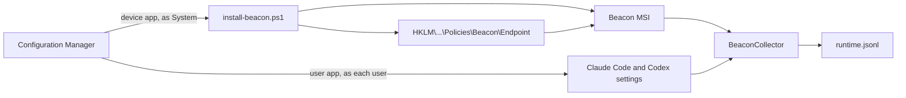

This guide takes you from no Beacon on your Windows desktops to every machine in a Configuration Manager (ConfigMgr, formerly SCCM) pilot collection recording its AI agent activity, attributed to the person who ran the agent. Follow the steps in order.

## What you'll set up

When you finish, each machine in the pilot has:

- Beacon installed from the MSI, with its collector running as the `BeaconCollector` Windows service.
- The fleet settings you chose, read from `HKLM\SOFTWARE\Policies\Beacon\Endpoint` on every install and upgrade.
- Claude Code and Codex reporting to that collector, for each person who signs in.
- Agent activity written to `C:\ProgramData\Beacon\Endpoint\logs\runtime.jsonl`, which only SYSTEM, Administrators and the `beacon-log` group can read.

You create two applications:

| Application | Deployed to | Runs as | Purpose |
| --- | --- | --- | --- |
| Beacon Endpoint Agent | A device collection | System | Writes the fleet settings, then installs the MSI |
| Beacon agent tools | A user collection | The signed-in user | Points each person's Claude Code and Codex at the collector |



To send the log on to a SIEM, add a forwarder after this guide; see [Log forwarding](/log-forwarding). The [Workspace ONE and Microsoft Sentinel guide](/guides/workspace-one-sentinel-mdm) shows the Sentinel forwarder script, which runs the same way from a ConfigMgr application or script.

## Before you start

| You need | Why |
| --- | --- |
| Configuration Manager current branch, with permission to create applications and deployments | Steps 2 and 3. |
| A pilot device collection of a few Windows x64 desktops, and a user collection for the people who use them | Scope both applications before a wider rollout. |
| A content source share the site can read | Holds the MSI and the two scripts. |
| A Beacon release newer than 1.3.57 | Earlier releases ignore the fleet settings. See [Fleet deployment](/platforms/fleet-deployment). |

There is no Windows ARM package. Scope the device collection to x64 machines, or add an operating system requirement to the deployment type.

Check the PowerShell execution policy on a pilot machine with `Get-ExecutionPolicy -List`. The MSI installs, upgrades and removes Beacon by running PowerShell scripts that are not signed yet, so it cannot run where Group Policy sets `MachinePolicy` to `AllSigned` or `Restricted`. On those machines the device application fails and nothing is installed, and a machine that already has Beacon keeps running it but cannot upgrade or remove it. Any other `MachinePolicy` value, including `Undefined`, is fine.

## 1. Prepare the content

Download `BeaconEndpointAgent-<version>-x64.msi` and its `.sha256` from the [releases page](https://github.com/asymptote-labs/agent-beacon/releases) and check it. The package is not code-signed yet, so the checksum is the only integrity check it has:

```powershell
(Get-FileHash BeaconEndpointAgent-<version>-x64.msi -Algorithm SHA256).Hash
```

Make one content folder per release, for example `\\cm01\Sources\Beacon\<version>\`, and put the MSI there with this script, saved as `install-beacon.ps1`:

```powershell title="install-beacon.ps1"
# Writes Beacon's fleet settings, then installs the MSI beside this script.
# Configuration Manager runs it as SYSTEM.
$ErrorActionPreference = 'Stop'

$key = 'HKLM:\SOFTWARE\Policies\Beacon\Endpoint'
New-Item -Path $key -Force | Out-Null
Set-ItemProperty -Path $key -Name BEACON_LOG_ACCESS -Value restricted
Set-ItemProperty -Path $key -Name BEACON_LOG_READERS -Value ''
Set-ItemProperty -Path $key -Name BEACON_DASHBOARD -Value disabled
Set-ItemProperty -Path $key -Name BEACON_ENDPOINT_HARNESSES -Value 'claude,codex'

$msi = Get-ChildItem -LiteralPath $PSScriptRoot -Filter 'BeaconEndpointAgent-*-x64.msi' | Select-Object -First 1
if (-not $msi) { Write-Error "No Beacon MSI in $PSScriptRoot"; exit 1 }
$log = Join-Path $env:SystemRoot 'Temp\beacon-msi-install.log'
$p = Start-Process msiexec.exe -Wait -PassThru -ArgumentList @(
    '/i', "`"$($msi.FullName)`"", '/qn', '/norestart', '/l*v', "`"$log`""
)
exit $p.ExitCode
```

The MSI cannot take environment variables from Configuration Manager, so its install step reads these settings as policy values instead. Writing them in the same script as the install guarantees they are there first. Change the values to suit your fleet:

| Value | What it does |
| --- | --- |
| `BEACON_LOG_ACCESS` | `restricted` keeps ordinary users from reading or writing the runtime log. See [Restricted log access](/security/restricted-log-access#on-windows). |
| `BEACON_LOG_READERS` | Accounts added to `beacon-log`, comma-separated as `DOMAIN\name`. Empty adds nobody. Add the account a log shipper reads the file as. |
| `BEACON_DASHBOARD` | `disabled` turns the local dashboard off. A silent install turns it off anyway unless this is `enabled`. See [Turning the dashboard off](/cli/dashboard#turning-the-dashboard-off). |
| `BEACON_ENDPOINT_HARNESSES` | The agent runtimes the collector is set up for. Use the same list in step 3. |

The full list of settings is in [Fleet deployment](/platforms/fleet-deployment).

If you already manage registry values with Group Policy, you can set the same values with a Group Policy registry preference instead and keep only the `msiexec` part of the script. Make sure the policy applies before the application installs; the values are read only when the MSI runs.

Keep `/norestart`. The package never needs a reboot, and without it Windows Installer can restart the machine on its own if something holds a file it has to replace.

## 2. Create the device application

In the Configuration Manager console, go to **Software Library > Application Management > Applications** and choose **Create Application**.

1. Choose **Windows Installer (\*.msi file)** and select the MSI in the content folder. The wizard reads the product code and fills in the detection method and uninstall program from it.
2. Name it `Beacon Endpoint Agent <version>`.
3. On **General Information**, change **Installation program** to:

   ```text
   powershell.exe -NoProfile -NonInteractive -ExecutionPolicy Bypass -File install-beacon.ps1
   ```

   Set **Install behavior** to **Install for system**.
4. Finish the wizard, then open the deployment type's properties and check these settings:

   | Tab | Setting | Value |
   | --- | --- | --- |
   | Content | Content location | The release's content folder, with the MSI and `install-beacon.ps1` |
   | Programs | Uninstall program | `msiexec /x {<product code>} /qn /norestart` (filled in by the wizard; add `/norestart`) |
   | Programs | Run installation and uninstall program as 32-bit process on 64-bit clients | Unchecked |
   | Detection Method | Windows Installer product code | The MSI's product code (filled in by the wizard) |
   | User Experience | Installation behavior | Install for system |
   | User Experience | Logon requirement | Whether or not a user is logged on |
   | User Experience | Installation program visibility | Hidden |
   | User Experience | Maximum allowed run time | 30 minutes. Beacon stops its own install step after 10 |

   Leave the return codes at their defaults. The script passes on the code `msiexec` exits with.
5. Distribute the content to your distribution points, then deploy the application to the pilot device collection with **Purpose: Required**.

Every release has its own product code, so detection matches only the exact version you deployed.

The MSI configures the agent tools of whoever is signed in at the console when it installs. Machines that install with nobody signed in, and other people who sign in later, are covered by step 3.

If you run AppLocker or Windows Defender Application Control, allow by path or file hash, since nothing here is code-signed yet:

- the MSI itself, and `install-beacon.ps1`;
- `beacon.exe`, `beacon-hooks.exe`, `beacon-otelcol.exe` and `vector.exe` in `C:\Program Files\Beacon\bin`;
- the package's PowerShell scripts in `C:\Program Files\Beacon\scripts`, which the MSI runs as SYSTEM;
- the copy of the hook program agents run from each profile, `%USERPROFILE%\.beacon\endpoint\hooks\beacon-hooks.exe`;
- `configure-agent-tools.ps1` from step 3.

**Success looks like:** the deployment reports success in **Monitoring > Deployments**, and on the machine `sc.exe query BeaconCollector` reports `RUNNING`.

## 3. Create the per-user application

Each person's Claude Code and Codex settings live in their own profile, so this step runs as each person who signs in. Save this script as `configure-agent-tools.ps1` in its own content folder, for example `\\cm01\Sources\Beacon\agent-tools\`:

```powershell title="configure-agent-tools.ps1"
# Points this person's agent runtimes at the Beacon collector.
# Configuration Manager runs it as the signed-in user.
$beacon = Join-Path $env:ProgramFiles 'Beacon\bin\beacon.exe'
if (-not (Test-Path -LiteralPath $beacon)) { Write-Error 'Beacon is not installed yet'; exit 1 }
& $beacon endpoint user-config repair-installed --system --harness claude,codex
if ($LASTEXITCODE -ne 0) { exit $LASTEXITCODE }

# Records that this ran, for the application's detection method.
$marker = Join-Path $env:LOCALAPPDATA 'Beacon\configmgr-agent-tools'
New-Item -ItemType Directory -Path (Split-Path $marker) -Force | Out-Null
Set-Content -LiteralPath $marker -Value (Get-Date -Format o)
exit 0
```

Use the same runtimes in `--harness` as in `BEACON_ENDPOINT_HARNESSES`.

Create a second application, this time choosing **Manually specify the application information**, with a **Script Installer** deployment type:

| Setting | Value |
| --- | --- |
| Content location | The `agent-tools` content folder |
| Installation program | `powershell.exe -NoProfile -NonInteractive -WindowStyle Hidden -ExecutionPolicy Bypass -File configure-agent-tools.ps1` |
| Detection method | **Use a custom script**, PowerShell, the script below |
| Installation behavior | Install for user |
| Logon requirement | Only when a user is logged on |
| Installation program visibility | Hidden |
| Run installation and uninstall program as 32-bit process on 64-bit clients | Unchecked. As a 32-bit process, the script looks for Beacon under `Program Files (x86)` and never finds it |

```powershell title="Detection script"
if (Test-Path -LiteralPath (Join-Path $env:LOCALAPPDATA 'Beacon\configmgr-agent-tools')) { 'Installed' }
```

Configuration Manager runs detection scripts under the client setting **Computer Agent > PowerShell execution policy**, which is **All Signed** by default and rejects this unsigned script. Set it to **Bypass** in the client settings deployed to the pilot machines, or sign the script. The installation programs pass `-ExecutionPolicy Bypass` themselves, but an execution policy set by Group Policy overrides that too, so check for one if either script never runs.

Deploy it to the pilot user collection with **Purpose: Required**. Configuration Manager then runs it once for each person when they sign in to a machine, including people who were not signed in when Beacon was installed. Until the device application has installed Beacon, the script fails, and Configuration Manager tries again at its next evaluation.

The hooks it installs run as that person, so their events carry the person's Windows account (their SID), which is how every event is attributed on a machine several people use.

**Success looks like:** the deployment reports success for the user, and `%USERPROFILE%\.claude\settings.json` contains `OTEL_EXPORTER_OTLP_ENDPOINT` and Beacon's hooks.

## 4. Check one machine

From an elevated PowerShell on a pilot machine:

```powershell
$beacon = Join-Path $env:ProgramFiles 'Beacon\bin\beacon.exe'
& $beacon endpoint status --system --json | ConvertFrom-Json | Select-Object log_access, dashboard
& $beacon endpoint doctor --system
```

Expect `log_access` to be `restricted`, `dashboard` to be `disabled`, and `runtime_log_access: ok` from `doctor`.

Then have someone send one prompt in Claude Code or Codex, and look at the newest events:

```powershell
Get-Content "$env:ProgramData\Beacon\Endpoint\logs\runtime.jsonl" -Tail 20 | ConvertFrom-Json |
  Select-Object @{n='action';e={$_.event.action}}, @{n='harness';e={$_.harness.name}}, @{n='user';e={$_.user.name}}
```

The person's account should appear, not the machine account (`COMPUTERNAME$`).

## Upgrades and removal

Beacon never updates itself, so the version on each machine is the one you deploy.

- **Upgrade:** make a content folder for the new release with its MSI and the same `install-beacon.ps1`, and create a new application from it as in step 2. On the new application, add a **supersedence** of the previous one, and leave **Uninstall** unchecked: the MSI removes the older version itself during the upgrade, keeping the endpoint's configuration, log access mode and `beacon-log` members, and reading the policy values again. Deploy the new application to the same collection. There is a short gap with no collector while the old one is replaced.
- **Uninstall:** deploy the application with **Action: Uninstall**. Removal stops and deletes the service and the program files, but leaves `C:\ProgramData\Beacon\Endpoint`, including the log. To remove that too, see [Uninstall](/platforms/windows#uninstall).
- **Roll back:** the MSI refuses to install over a newer version. Uninstall the newer application first, then deploy the older one.

The per-user application needs no change for an upgrade. If you change `--harness`, rename the marker file in both scripts (for example `configmgr-agent-tools-2`) so the application runs again for everyone.

## Troubleshooting

| What you see | Likely cause |
| --- | --- |
| The device application fails with exit code 1603 | Beacon's own install step failed. Its log is `beacon-package-*.log` in `C:\Windows\Temp`, or `C:\Windows\SystemTemp` on newer Windows builds; `C:\Windows\Temp\beacon-msi-install.log` has what Windows Installer did. See [Windows install](/platforms/windows) to find them. |
| The device application fails, and `Get-ExecutionPolicy -List` shows `AllSigned` or `Restricted` for `MachinePolicy` | Group Policy blocks unsigned PowerShell scripts, which the MSI needs. See [Before you start](#before-you-start). |
| The device application fails with "No Beacon MSI" | The content folder has only the script. Put the MSI beside it and update the content on the distribution points. |
| The MSI fails with "A newer version is already installed" | The machine already has a newer Beacon. Deploy the newer application, or uninstall it first to roll back. |
| `log_access` is not `restricted` | The policy values were not there when the MSI ran, or the release is 1.3.57 or earlier. Check `HKLM\SOFTWARE\Policies\Beacon\Endpoint`, then run `beacon endpoint repair --system --log-access restricted` or redeploy. |
| The per-user application keeps failing | The device application has not installed Beacon on that machine yet, and it succeeds at the next evaluation after the install. If Beacon is installed, check the 32-bit process setting on the deployment type. |
| The per-user application ran but reports failure, or detection always fails | The detection script was blocked by the PowerShell execution policy. See the note under step 3. |
| Events arrive under `COMPUTERNAME$` | That person's agent tools are not set up yet: check the per-user deployment for them. |
| An install step or a hook is blocked | AppLocker or WDAC; allow everything listed in step 2. |

See [Windows install](/platforms/windows) for the install logs, time limits and what the install changes on the machine.

## Related

<Columns cols={2}>
  <Card title="Fleet deployment" icon="building" href="/platforms/fleet-deployment">
    Every fleet setting, version pinning, and how to check a machine.
  </Card>
  <Card title="Windows install" icon="windows" href="/platforms/windows">
    The MSI, the service, and how upgrades and uninstall work.
  </Card>
  <Card title="Restricted log access" icon="lock" href="/security/restricted-log-access">
    Who can read and write the runtime log.
  </Card>
  <Card title="Log forwarding" icon="tower-broadcast" href="/log-forwarding">
    Send Beacon events to your SIEM or a customer-managed pipeline.
  </Card>
</Columns>
