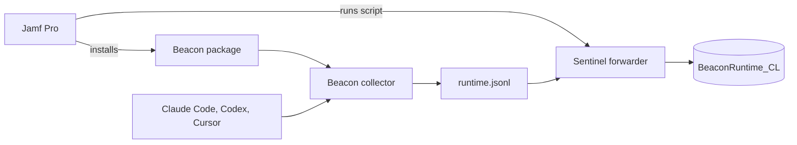

This guide takes you from no Beacon on your Macs to every Mac in a Jamf pilot sending its AI agent activity to one Microsoft Sentinel table. Follow the steps in order.

A Homebrew install on one Mac is only for looking at events locally. It does not include Vector, and it writes a per-user log. The Macs in the pilot use the signed package, which writes `/var/log/beacon-agent/runtime.jsonl` and ships Vector at `/opt/beacon/bin/vector`.

## What you'll set up

When you finish, each Mac in the pilot has:

- Beacon installed under `/opt/beacon`, with its collector running as the LaunchDaemon `com.beacon.endpoint.collector`.
- Claude Code, Codex CLI, and Cursor reporting to that collector for the user who is logged in at the Mac.
- Agent activity written to `/var/log/beacon-agent/runtime.jsonl`.
- A forwarder (Vector, shipped in the package) posting each new line to the Azure Monitor Logs Ingestion API.

Those lines land in the custom Log Analytics table `BeaconRuntime_CL`, which is the table Sentinel hunts over. Azure Monitor Agent does not run on macOS, so this guide uses Vector. Linux hosts can use Azure Monitor Agent and still fill the same table. See [Microsoft Sentinel forwarding](/log-forwarding/microsoft-sentinel).



## Before you start

| You need | Why |
| --- | --- |
| Jamf Pro, with a pilot Smart Group of a few test Macs | Scope the policies before a wider rollout. |
| Apple Silicon Macs | The signed Beacon package is Apple Silicon only. |
| A Log Analytics workspace with Microsoft Sentinel enabled | Step 2. |
| Permission to create a Data Collection Endpoint, deploy a Data Collection Rule, and register an app in Microsoft Entra ID | Step 2. The app needs the Monitoring Metrics Publisher role on that rule. |
| A person logged in at the Mac when the harness policies run | Hook and OTLP settings are written into that person's home directory. |

The Macs do not need Beacon installed beforehand. Jamf installs it in Policy 1.

<Note>
  Claude Desktop chat is not part of this rollout. Beacon does not collect that app. Claude Code is the `claude` CLI and the Claude Code extension. Codex is the Codex CLI. Cursor is the Cursor app.
</Note>

## 1. Look at Beacon on one Mac (optional)

A Homebrew install lets you see what a session looks like before Jamf is involved. It stays on that Mac:

```bash
brew update
brew trust asymptote-labs/tap
brew tap asymptote-labs/tap
brew install beacon
beacon endpoint install
```

Check it with `beacon endpoint status` and `beacon endpoint doctor`. A fresh install reports one warning, `harness_observed`, until an agent actually runs. Start a new Claude Code or Codex session and the events are in `~/.beacon/endpoint/logs/runtime.jsonl`.

Leave this Mac as it is. The pilot Macs get the package in Policy 1, and they forward a different log.

## 2. Prepare Sentinel

Do this once, in Azure. The same workspace then receives every pilot Mac.

On the Mac from step 1, generate the content pack with the system log path filled in. `--system` is what makes `vector.toml` tail `/var/log/beacon-agent/runtime.jsonl`:

```bash
beacon endpoint sentinel install-pack --system --output ./beacon-sentinel-pack
```

The pack contains the table schema, both Data Collection Rule templates, `vector.toml`, the KQL transform, starter hunting queries, and a sample event. Full portal steps are in [Microsoft Sentinel forwarding](/log-forwarding/microsoft-sentinel). For these Macs, finish these four things:

1. Create the custom table. Name it `BeaconRuntime`. Azure adds `_CL`, so the table you query is `BeaconRuntime_CL`. Upload `sample-event.jsonl` and paste `dcr-transform.kql` in the schema step.
2. Create a Data Collection Endpoint in the same region as the workspace. Copy its logs ingestion URL. It looks like `https://<dce>.<region>.ingest.monitor.azure.com`.
3. Deploy `dcr-logs-ingestion-template.json` with the workspace resource ID and the Data Collection Endpoint resource ID. Copy the rule's `immutableId`. It starts with `dcr-`.
4. Register an app in Microsoft Entra ID, create a client secret, and grant that app the **Monitoring Metrics Publisher** role on the Data Collection Rule. Role assignment can take several minutes.

Each Mac needs outbound HTTPS to `login.microsoftonline.com` and to the Data Collection Endpoint hostname. Nothing else.

Beacon never stores the tenant ID, client secret, workspace ID, or ingestion URL. Those stay in the forwarder's environment file on the Mac, written by Policy 2.

## 3. Set up Jamf

Create four policies, in this order, scoped to the pilot Smart Group. A person has to be logged in at the Mac for policies 3 and 4. At the login window those two exit with an error, which is expected.

| Order | Policy | Runs as | Purpose |
| --- | --- | --- | --- |
| 1 | Install Beacon package | root | Installs Beacon, the collector, and Vector |
| 2 | Forward to Sentinel | root | Starts the Vector LaunchDaemon |
| 3 | Claude Code and Codex | root, someone logged in | Points both at the collector and installs their hooks |
| 4 | Cursor hooks | root, someone logged in | Installs Cursor hooks for that person |

### Policy 1: install the package

Download the signed package for the release you are piloting. The asset name is `BeaconEndpointAgent-<version>-arm64.pkg`, attached to the [GitHub release](https://github.com/asymptote-labs/agent-beacon/releases) with a `.sha256`. Check the checksum before uploading it to Jamf.

In Jamf Pro, upload the package and add it to a policy named `Beacon - Install Package` with the install action. The package installs:

```text
/opt/beacon/bin/beacon
/opt/beacon/bin/beacon-otelcol
/opt/beacon/bin/vector
/opt/beacon/jamf/claude/common/repair-hooks.sh
/opt/beacon/jamf/scripts/install-cursor-hooks.sh
```

It also starts the collector LaunchDaemon and, when someone is logged in during install, points that person's Claude Code and Codex settings at the collector. Policy 3 does that again on purpose, so a Mac that was at the login window during install still gets configured.

### Policy 2: forward to Sentinel

Add a script named `Beacon - Configure Sentinel Forwarding`. It writes Vector's config, a root-owned environment file, a small wrapper, and a LaunchDaemon, then starts it.

Jamf script parameters:

| Parameter | Label | Example |
| --- | --- | --- |
| 4 | Data Collection Endpoint URL | `https://dce-beacon.eastus-1.ingest.monitor.azure.com` |
| 5 | DCR immutable ID | `dcr-xxxxxxxxxxxxxxxxxxxxxxxxxxxxxxxx` |
| 6 | Entra tenant ID | `00000000-0000-0000-0000-000000000000` |
| 7 | Entra client ID | `00000000-0000-0000-0000-000000000000` |
| 8 | Entra client secret | the secret from step 2 |

Deliver the secret with Jamf's own secret mechanism if you have one. A script parameter is visible to Jamf administrators.

```bash
#!/bin/bash
set -euo pipefail

DCE_ENDPOINT="${4:?parameter 4 is the Data Collection Endpoint URL}"
DCR_IMMUTABLE_ID="${5:?parameter 5 is the DCR immutable ID}"
AZURE_TENANT_ID="${6:?parameter 6 is the Entra tenant ID}"
AZURE_CLIENT_ID="${7:?parameter 7 is the Entra client ID}"
AZURE_CLIENT_SECRET="${8:?parameter 8 is the Entra client secret}"

LABEL="com.beacon.endpoint.sentinel-forwarder"
VECTOR_BIN="/opt/beacon/bin/vector"
BASE_DIR="/Library/Application Support/Beacon/Forwarders"
CONFIG_PATH="$BASE_DIR/sentinel-vector.toml"
ENV_PATH="$BASE_DIR/sentinel-vector.env"
WRAPPER="$BASE_DIR/run-sentinel-forwarder.sh"
LOG_DIR="/Library/Logs/Beacon"
PLIST_PATH="/Library/LaunchDaemons/$LABEL.plist"
DATA_DIR="/var/lib/vector/beacon-sentinel"

if [ ! -x "$VECTOR_BIN" ]; then
  echo "Vector not found at $VECTOR_BIN. Install the Beacon package first." >&2
  exit 1
fi

shell_quote() {
  printf "'%s'" "$(printf '%s' "$1" | sed "s/'/'\\\\''/g")"
}

mkdir -p "$BASE_DIR" "$LOG_DIR" "$DATA_DIR"
chmod 0755 "$BASE_DIR" "$LOG_DIR" "$DATA_DIR"

# This is vector.toml from `beacon endpoint sentinel install-pack --system`.
# Replace this block if a newer pack changes it.
cat >"$CONFIG_PATH" <<'EOF'
data_dir = "/var/lib/vector/beacon-sentinel"

[sources.beacon_runtime]
type = "file"
include = ["/var/log/beacon-agent/runtime.jsonl"]
read_from = "end"

[transforms.beacon_raw_record]
type = "remap"
inputs = ["beacon_runtime"]
source = '''
raw = string!(.message)
parsed, err = parse_json(raw)
ts = now()
if err == null && is_object(parsed) {
  ts = parse_timestamp(parsed.timestamp, format: "%+") ?? now()
}
. = {"RawData": raw}
.timestamp = ts
'''

[sinks.beacon_sentinel]
type = "azure_logs_ingestion"
inputs = ["beacon_raw_record"]
endpoint = "${BEACON_SENTINEL_DCE_ENDPOINT}"
dcr_immutable_id = "${BEACON_SENTINEL_DCR_IMMUTABLE_ID}"
stream_name = "Custom-BeaconRuntimeRaw"
timestamp_field = "TimeGenerated"

[sinks.beacon_sentinel.auth]
azure_credential_kind = "client_secret_credential"
azure_tenant_id = "${AZURE_TENANT_ID}"
azure_client_id = "${AZURE_CLIENT_ID}"
azure_client_secret = "${AZURE_CLIENT_SECRET}"

[sinks.beacon_sentinel.batch]
max_bytes = 524288
max_events = 1000
timeout_secs = 30

[sinks.beacon_sentinel.request]
retry_attempts = 10
retry_initial_backoff_secs = 1
retry_max_duration_secs = 300
EOF
chmod 0644 "$CONFIG_PATH"

{
  printf 'export BEACON_SENTINEL_DCE_ENDPOINT=%s\n' "$(shell_quote "$DCE_ENDPOINT")"
  printf 'export BEACON_SENTINEL_DCR_IMMUTABLE_ID=%s\n' "$(shell_quote "$DCR_IMMUTABLE_ID")"
  printf 'export AZURE_TENANT_ID=%s\n' "$(shell_quote "$AZURE_TENANT_ID")"
  printf 'export AZURE_CLIENT_ID=%s\n' "$(shell_quote "$AZURE_CLIENT_ID")"
  printf 'export AZURE_CLIENT_SECRET=%s\n' "$(shell_quote "$AZURE_CLIENT_SECRET")"
} >"$ENV_PATH"
chmod 0600 "$ENV_PATH"

cat >"$WRAPPER" <<'EOF'
#!/bin/sh
set -eu
ENV_PATH="/Library/Application Support/Beacon/Forwarders/sentinel-vector.env"
CONFIG_PATH="/Library/Application Support/Beacon/Forwarders/sentinel-vector.toml"
# shellcheck disable=SC1090
. "$ENV_PATH"
exec /opt/beacon/bin/vector --config "$CONFIG_PATH"
EOF
chmod 0755 "$WRAPPER"

cat >"$PLIST_PATH" <<EOF
<?xml version="1.0" encoding="UTF-8"?>
<!DOCTYPE plist PUBLIC "-//Apple//DTD PLIST 1.0//EN" "http://www.apple.com/DTDs/PropertyList-1.0.dtd">
<plist version="1.0">
<dict>
  <key>Label</key>
  <string>$LABEL</string>
  <key>ProgramArguments</key>
  <array>
    <string>$WRAPPER</string>
  </array>
  <key>RunAtLoad</key>
  <true/>
  <key>KeepAlive</key>
  <true/>
  <key>StandardOutPath</key>
  <string>$LOG_DIR/$LABEL.out</string>
  <key>StandardErrorPath</key>
  <string>$LOG_DIR/$LABEL.err</string>
</dict>
</plist>
EOF
chmod 0644 "$PLIST_PATH"

# shellcheck disable=SC1090
. "$ENV_PATH"
"$VECTOR_BIN" validate --skip-healthchecks "$CONFIG_PATH"

target="system/$LABEL"
launchctl bootout "$target" >/dev/null 2>&1 || true
attempts=0
while launchctl print "$target" >/dev/null 2>&1; do
  attempts=$((attempts + 1))
  if [ "$attempts" -ge 65 ]; then
    echo "Timed out waiting for $LABEL to stop" >&2
    exit 1
  fi
  sleep 1
done
launchctl bootstrap system "$PLIST_PATH" >/dev/null 2>&1 || {
  echo "Could not bootstrap $LABEL" >&2
  exit 1
}
launchctl print "$target"
```

Vector starts reading at the end of the log. Lines already in the file are not uploaded. That is what you want on a pilot: only activity from the moment forwarding starts.

The client secret lives only in `sentinel-vector.env`, mode `0600`, owned by root. It is not in Beacon's `config.json`.

### Policy 3: Claude Code and Codex

Add a script that runs the helper shipped in the package:

```bash
#!/bin/bash
set -euo pipefail
/opt/beacon/jamf/claude/common/repair-hooks.sh
```

Run it while someone is logged in. The helper repairs the system endpoint for Claude Code and Codex, then installs Claude Code hooks for that person, writing events to `/var/log/beacon-agent/runtime.jsonl`.

Codex sends prompts, tools, and token usage over OTLP to `127.0.0.1:4317`. Its SessionStart hook adds the OS user, which the OTLP spans do not carry. Claude Code sends prompts, tools, approvals, and token usage over the same OTLP endpoint. Its hooks add session start and end, file activity, command output, and subagent lifecycle, which Claude Code's OTLP export does not carry.

After the policy, that person quits Claude Code and Codex completely, reopens them, and starts a new session. A session that was already open keeps the old settings.

### Policy 4: Cursor

Add a script that runs the other helper shipped in the package:

```bash
#!/bin/bash
set -euo pipefail
/opt/beacon/jamf/scripts/install-cursor-hooks.sh
```

This also has to run while someone is logged in. It installs Cursor hooks for that person and points them at the system runtime log. Quit Cursor and start a new agent session afterward.

## What each harness sends

| Harness | How it is configured | What arrives in `BeaconRuntime_CL` |
| --- | --- | --- |
| Claude Code (`claude_code`) | Policy 3. OTLP in `~/.claude/settings.json`, plus hooks | Prompts, tools, commands, approvals, token usage. Hooks add session lifecycle, file activity, and command output |
| Codex CLI (`codex_cli`) | Policy 3. OTLP in `~/.codex/config.toml`, plus a SessionStart hook | Prompts, tools, and token usage, with the OS user from the hook |
| Cursor (`cursor`) | Policy 4. Hooks in `~/.cursor/hooks.json` | Prompts, tool calls, shell commands, file edits, and approvals |

Events from these three are rows in the same table. Filter with `HarnessName`.

Other local agents are installed the same way, one policy per harness, with `beacon endpoint hooks install` or that runtime's own setup. The [runtime list](/runtimes) is the catalog. This pilot does not turn on Claude Cowork. Cowork is an org-admin OTLP export, documented on [Claude Cowork](/runtimes/claude-cowork), and it is a different harness name (`claude_cowork`).

## 4. Check one Mac

On a pilot Mac, after all four policies and a new session in each agent:

```bash
sudo /opt/beacon/bin/beacon endpoint status --system
/opt/beacon/bin/beacon endpoint hooks status --harness claude
/opt/beacon/bin/beacon endpoint hooks status --harness cursor
launchctl print system/com.beacon.endpoint.sentinel-forwarder
```

`Service: loaded=true running=true` means the collector is up. Run the two hooks checks as the person who is logged in. They read that person's home, the same place Policies 3 and 4 wrote: Claude Code should say hooks are installed at that person's `~/.claude/settings.json`, and Cursor at that person's `~/.cursor/hooks.json`. The forwarder print should show `state = running`.

Write a known event after the forwarder is running, so Vector is already watching the end of the file:

```bash
sudo /opt/beacon/bin/beacon endpoint sentinel validate --system
```

Then in the Log Analytics workspace:

```kql
BeaconRuntime_CL
| where TimeGenerated > ago(1h)
| where Message has "Beacon endpoint Sentinel validation event"
| project TimeGenerated, HostName, UserName, HarnessName, EventAction, Message
```

A real session shows up next to it:

```kql
BeaconRuntime_CL
| where TimeGenerated > ago(1h)
| where HarnessName in ("claude_code", "codex_cli", "cursor")
| summarize count() by HarnessName, EventAction, UserName
```

If the validation query is empty, read `/Library/Logs/Beacon/com.beacon.endpoint.sentinel-forwarder.err` on the Mac. An authentication error there is the Entra app or the Monitoring Metrics Publisher role. A path error means Vector is not reading `/var/log/beacon-agent/runtime.jsonl`. Rows in the local file with no matching rows in the table mean the forwarder started before those lines were written: Vector only ships lines appended after it starts.

## Related

<Columns cols={2}>
  <Card title="Microsoft Sentinel forwarding" icon="chart-line" href="/log-forwarding/microsoft-sentinel">
    Table setup, both ingestion paths, and the content pack.
  </Card>
  <Card title="macOS" icon="apple" href="/platforms/macos">
    Package install, launchd, and the system log path.
  </Card>
  <Card title="Jamf" icon="screwdriver-wrench" href="/mdm/jamf">
    Package deployment, Extension Attributes, and validation.
  </Card>
  <Card title="Anthropic, OpenAI, and Cursor" icon="list-check" href="/guides/jamf-anthropic-openai-cursor-mdm">
    The same three harnesses, forwarding to S3 instead of Sentinel.
  </Card>
</Columns>
