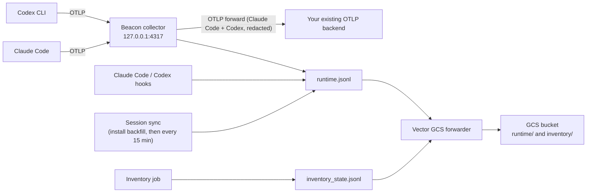

## Overview

Use this runbook when you deploy Beacon with Kandji, want all Beacon telemetry in a Google Cloud Storage (GCS) bucket, and your Macs already send Claude Code and Codex CLI OpenTelemetry (OTLP) to another backend, such as a token-usage or cost platform, that must keep receiving it.

Claude Code and Codex each export OTLP to one endpoint. Beacon needs that export to arrive at its local collector, so installing Beacon points both runtimes at `127.0.0.1:4317`, and the runtimes stop sending to the backend you already had. This setup keeps both destinations fed:



| Destination | What it receives | How |
| --- | --- | --- |
| GCS bucket | Everything Beacon records: Claude Code and Codex OTLP (normalized into Beacon events), hook events (prompts, tools, commands, files, sessions), records read from the runtimes' local session files, and endpoint inventory | The packaged Vector forwarder, `com.beacon.endpoint.gcs-forwarder`, tails the local JSONL logs and uploads them |
| Existing OTLP backend | The Claude Code and Codex OTLP it received before Beacon, with secrets redacted | The collector's OTLP forward |

The two are independent: the GCS forwarder reads Beacon's local logs, and the forward runs inside the collector. Either keeps working when the other's destination is down, and repairs and package upgrades keep both.

Kandji provides the deployment layer:

| Kandji item | Beacon use |
| --- | --- |
| Custom App: GCS writer key | Writes the GCS service-account key to a root-only file, separately from Beacon, so it can be rotated without touching Beacon. |
| Custom App: Beacon package | Installs Beacon, which creates the system endpoint and points Claude Code and Codex at the local collector. Its post-install script turns on the OTLP forward straight away, so the existing backend misses nothing. |
| Custom Script (audit and remediation) | Configures the GCS forwarder, re-applies the forward and the runtime settings, and repairs them if they drift, for example after a runtime update or a user's first login. |

<Info>
  The OTLP forward needs the first Beacon release after v1.3.51. An older package does not have the `--otlp-forward-*` flags, and its collector has no OTLP exporter. GCS forwarding works with current packages.
</Info>

## What the existing backend receives

The forward has its own collector pipelines, fed by the same receiver as Beacon's. The backend receives the OTLP logs, metrics and traces Claude Code and Codex send, in OTLP form rather than Beacon's event schema, with three differences from the raw export:

- **Only Claude Code and Codex.** Other OTLP the collector receives stays local (it still reaches GCS through Beacon's log): Gemini CLI, VS Code, SDK apps, and Beacon's browser extension, which carries full claude.ai and ChatGPT chats. `--otlp-forward-harness` names a different list.
- **Secrets redacted.** Credentials found in prompts, commands and tool arguments are replaced with `[REDACTED]`, the same redaction Beacon applies before Splunk and Falcon. Token counts, cost, models and session ids are untouched.
- **No raw API bodies.** Claude Code API body events get the same handling as in Beacon's own log.

Hook events and session-file data never pass through the collector, so the forward does not carry them; they go to GCS.

If the backend is down or slow, the forward retries for up to two minutes and holds at most a small queue, then drops what it cannot send. Beacon's local capture and the GCS upload never wait on it.

What the runtimes send is set by Beacon's runtime settings, which can differ from the settings you rolled out for the backend. Check these with the backend's owner before rollout:

| Runtime | Beacon setting | Effect on the existing backend |
| --- | --- | --- |
| Claude Code | `OTEL_LOG_USER_PROMPTS=1`, `OTEL_LOG_TOOL_DETAILS=1` | The backend now receives prompt text and tool details (commands, file paths, MCP arguments) if it did not before. |
| Claude Code | `OTEL_EXPORTER_OTLP_METRICS_TEMPORALITY_PREFERENCE=delta` | Metrics such as `claude_code.token.usage` and `claude_code.cost.usage` arrive as per-interval deltas. A backend that expects cumulative counters must accept delta temporality. |
| Claude Code | Logs, metrics and traces all go to the collector over gRPC | Per-signal endpoints and headers from your earlier rollout are overridden, so every signal reaches the backend through the forward. |
| Codex CLI | `[otel]` with a log exporter and a trace exporter, and no metrics exporter | The backend receives Codex logs and the turn traces that carry token usage, and no Codex metrics. |

## Prerequisites

- A signed and notarized `BeaconEndpointAgent-<version>-arm64.pkg`, from the first release after v1.3.51. It includes `/opt/beacon/bin/vector`, which the GCS forwarder uses. The endpoint package is for Apple Silicon Macs.
- A pilot Kandji Blueprint, or an assignment rule on each library item, that targets a few Macs with Claude Code or Codex CLI installed.
- A Google Cloud project where you can create a bucket and service accounts, and a policy decision that permits a service-account key on managed Macs. The packaged Vector authenticates to GCS with a service-account JSON key; Workload Identity Federation and interactive Application Default Credentials are not supported for this LaunchDaemon.
- The OTLP settings your Macs use for the existing backend today:
  - **Endpoint**: for gRPC, `host:port` or a URL; for HTTP, the base URL without `/v1/logs`.
  - **Protocol**: `grpc` or `http/protobuf`.
  - **Headers**: usually an API key or authorization header, from `OTEL_EXPORTER_OTLP_HEADERS` in Claude Code's settings or `headers` in Codex's `[otel.exporter.*]` table.
- A security decision that prompt, command, tool, file, model and inventory telemetry may be written to your GCS bucket.

<Warning>
  Kandji's documentation covers Custom Apps with pre- and post-install scripts and Custom Scripts with audit and remediation scripts. It does not document how long a Custom App's post-install script may run, or ordering between library items. The flow below does not depend on ordering: the recurring Custom Script converges each Mac once the package and the key have both arrived. Treat run times and ordering as pilot acceptance checks in your tenant.
</Warning>

## Step 1: stop the old direct export from fighting Beacon

How you rolled out the existing backend decides what to change. Find the one that matches.

**Claude Code managed settings** (`/Library/Application Support/ClaudeCode/managed-settings.json`, delivered by a Kandji profile or script). Managed settings take precedence over the user's `~/.claude/settings.json`, where Beacon writes its endpoint, so Claude Code would keep exporting straight to the backend and Beacon would get no Claude OTLP. In the managed settings `env`:

- Set `OTEL_EXPORTER_OTLP_ENDPOINT` to `http://127.0.0.1:4317` and `OTEL_EXPORTER_OTLP_PROTOCOL` to `grpc`.
- Remove `OTEL_EXPORTER_OTLP_HEADERS`, every `OTEL_EXPORTER_OTLP_{LOGS,METRICS,TRACES}_ENDPOINT` and `_HEADERS`, and `BETA_TRACING_ENDPOINT`. The backend's credentials move to the forward in Step 5. Left in place, they would be sent to the local collector instead.

**Scripts or profiles that write `~/.claude/settings.json` or `~/.codex/config.toml`.** Beacon rewrites the OTLP settings in both files on every install, upgrade and repair, and replaces Codex's whole `[otel]` table. Retire or unscope the Kandji item that writes the backend's OTLP settings to those files; otherwise it and Beacon overwrite each other on every run. If the backend's own agent rewrites them and cannot be turned off, see [When another tool rewrites the OTLP settings](#when-another-tool-rewrites-the-otlp-settings).

## Step 2: prepare Google Cloud

Beacon's [GCS Terraform module](/log-forwarding/gcs-terraform) creates a dedicated bucket, an upload-only writer service account limited to the Beacon prefix, and an optional read-only service account for checking deliveries:

```hcl title="main.tf"
module "beacon_gcs" {
  source = "github.com/asymptote-labs/agent-beacon//terraform/gcs?ref=v1.3.38"

  project       = "<project-id>"
  location      = "<region>" # for example us-central1
  bucket_name   = "<globally-unique-bucket>"
  prefix        = "beacon-prod"
  create_reader = true
}

output "bucket_name"  { value = module.beacon_gcs.bucket_name }
output "prefix"       { value = module.beacon_gcs.prefix }
output "writer_email" { value = module.beacon_gcs.writer_email }
output "reader_email" { value = module.beacon_gcs.reader_email }
```

```bash
terraform init
terraform apply

export GCP_PROJECT="<project-id>"
export BEACON_GCS_BUCKET="$(terraform output -raw bucket_name)"
export BEACON_GCS_PREFIX="$(terraform output -raw prefix)"
export BEACON_GCS_WRITER_EMAIL="$(terraform output -raw writer_email)"
export BEACON_GCS_READER_EMAIL="$(terraform output -raw reader_email)"
```

The writer has `roles/storage.objectCreator`: it can create objects and cannot list, read, overwrite or delete them. Validate uploads with the reader. To do the same with `gcloud`, or to add lifecycle rules or CMEK, see [GCS with Terraform](/log-forwarding/gcs-terraform) and the gcloud steps in [Rippling and GCS](/guides/rippling-gcs-mdm#1-prepare-google-cloud).

Create the writer's key on an administrator workstation:

```bash
umask 077
gcloud iam service-accounts keys create ./beacon-gcs-writer.json \
  --project "$GCP_PROJECT" \
  --iam-account "$BEACON_GCS_WRITER_EMAIL"
```

## Step 3: deliver the GCS writer key with its own Custom App

Kandji has no secret store, and Kandji admins can read script text, so do not paste the key into a script. Package it as its own installer and deploy that as a Custom App. The key then lives at a fixed path outside Beacon's directories, and rotating it is a new key package, with no change to Beacon.

The endpoint path used in the rest of this guide (replace the organization name):

```text
/Library/Application Support/Your Organization/Secrets/beacon-gcs-writer.json
```

Build the package:

```bash
umask 077
mkdir -p "payload/Library/Application Support/Your Organization/Secrets"
cp ./beacon-gcs-writer.json "payload/Library/Application Support/Your Organization/Secrets/"
chmod 700 "payload/Library/Application Support/Your Organization/Secrets"
chmod 600 "payload/Library/Application Support/Your Organization/Secrets/beacon-gcs-writer.json"

pkgbuild --root payload \
  --identifier com.yourorg.beacon-gcs-writer \
  --version 1 \
  --ownership recommended \
  beacon-gcs-writer-1.pkg
```

`--ownership recommended` installs the files as `root:wheel` with the modes above. Sign the package with your Developer ID Installer certificate (`productsign`) if your Kandji setup requires signed packages. Delete the local key and payload once the package is uploaded, and restrict who can download it from Kandji.

In Kandji, add a **Custom App** named `Beacon GCS writer key`, install type **Package**, upload the package, choose **Install once per device**, and assign it to the pilot Blueprint.

## Step 4: add the Beacon package as a Custom App

Add another **Custom App**:

1. Name it `Beacon Endpoint Agent`.
2. Set the install type to **Package** and upload the Beacon `.pkg`.
3. Choose **Install once per device** (or self-service for the pilot).
4. Leave the pre-install script empty.
5. Paste the post-install script from Step 5.
6. Assign it to the pilot Blueprint.

The package postinstall installs Beacon under `/opt/beacon`, writes the system endpoint configuration, starts `com.beacon.endpoint.collector`, and points the logged-in user's Claude Code and Codex at the collector (`~/.claude/settings.json` and `~/.codex/config.toml`), with Beacon's Claude Code and Codex hooks.

## Step 5: turn on the OTLP forward (post-install script)

Use this script as the Beacon Custom App's **post-install script**. It turns the forward on as soon as Beacon is installed, before the GCS key may have arrived. Replace the three values at the top with the endpoint, protocol and headers from the prerequisites:

```bash title="Beacon - OTLP forward (post-install script)"
#!/bin/bash
set -euo pipefail

# The existing backend's OTLP settings.
OTLP_FORWARD_ENDPOINT="https://otlp.backend.example:4317"
OTLP_FORWARD_PROTOCOL="grpc"           # or http/protobuf
OTLP_FORWARD_HEADERS=(                 # one name=value per entry; may be empty
  "authorization=Bearer <backend-api-key>"
)

BEACON=/opt/beacon/bin/beacon

args=(endpoint repair --system
  --collector /opt/beacon/bin/beacon-otelcol
  --harness claude,codex
  --session-sync
  --otlp-forward-endpoint "$OTLP_FORWARD_ENDPOINT"
  --otlp-forward-protocol "$OTLP_FORWARD_PROTOCOL")
for header in ${OTLP_FORWARD_HEADERS[@]+"${OTLP_FORWARD_HEADERS[@]}"}; do
  args+=(--otlp-forward-header "$header")
done

"$BEACON" "${args[@]}"

# Point the logged-in user's Claude Code and Codex at the collector. This does nothing
# when nobody is logged in; the Custom Script in Step 6 catches that user later.
"$BEACON" endpoint user-config repair-installed --system --harness claude,codex
```

`--session-sync` turns on the [scheduled session sync](/cli/endpoint-install#scheduled-session-sync): every 15 minutes a root job reads new records from the logged-in user's Claude Code and Codex session files into the runtime log, so what only those files hold, such as per-request token usage and full assistant replies, reaches GCS too. It is off by default; repairs and upgrades keep it once set.

`beacon endpoint repair` stores the forward in `/Library/Application Support/Beacon/Endpoint/config.json` and renders it into the collector config next to it. Header values are usually credentials, so they go to a root-only file beside it, `otlp-forward-headers.json` (`0600`), and into the collector config, which is also `0600`. `config.json` keeps only the header names and stays readable, because the logged-in user's `beacon` commands read it to find the system log. Package upgrades and later repairs, including the GCS helper's, keep the forward; you do not pass the flags again. To remove it, run `beacon endpoint repair --system --no-otlp-forward`.

Flags you may also need:

| Flag | Use |
| --- | --- |
| `--otlp-forward-insecure` | The backend takes plaintext gRPC (a collector on your network, for example). |
| `--otlp-forward-ca-file <path>` | The backend's certificate is issued by a private CA. |
| `--otlp-forward-insecure-skip-verify` | Testing only. |

<Note>
  This script holds the backend's API key, and Kandji admins can read Custom App scripts. If that is not acceptable, deliver the key the way Step 3 delivers the GCS key, as a root-only file in its own package, and read it into `OTLP_FORWARD_HEADERS` here and in Step 6. Beacon never prints header values: `beacon endpoint status` and `beacon endpoint doctor` list header names only.
</Note>

## Step 6: configure GCS and keep everything applied (Custom Script)

Add a **Custom Script** library item, set it to **Run every 15 minutes** during rollout (daily once the pilot is stable), and assign it to the same Blueprint. Its remediation configures the GCS forwarder once the key has arrived, and both scripts together repair anything that drifts.

**Audit script:** exits non-zero, which runs the remediation, when the GCS forwarder is not running, the forward is missing, or the logged-in user's runtimes are not pointed at the collector:

```bash title="Beacon - GCS and OTLP forward (audit)"
#!/bin/bash
BEACON=/opt/beacon/bin/beacon
[ -x "$BEACON" ] || exit 0   # Beacon not installed yet; its Custom App handles that.

/bin/launchctl print system/com.beacon.endpoint.gcs-forwarder 2>/dev/null \
  | /usr/bin/grep -q 'state = running' || exit 1

status="$("$BEACON" endpoint status --system --json 2>/dev/null)" || exit 1
echo "$status" | /usr/bin/grep -q '"otlp_forward":{"configured":true' || exit 1

console_user="$(/usr/bin/stat -f %Su /dev/console)"
case "$console_user" in root|loginwindow|_mbsetupuser|"") exit 0 ;; esac
home="$(/usr/bin/dscl . -read "/Users/$console_user" NFSHomeDirectory | /usr/bin/awk '{print $2}')"

if [ -d "$home/.claude" ]; then
  /usr/bin/grep -q '127.0.0.1:4317' "$home/.claude/settings.json" 2>/dev/null || exit 1
fi
if [ -d "$home/.codex" ]; then
  /usr/bin/grep -q '127.0.0.1:4317' "$home/.codex/config.toml" 2>/dev/null || exit 1
fi
exit 0
```

**Remediation script:** re-applies the forward, then installs or repairs the GCS forwarder with the packaged helper. Replace the values at the top:

```bash title="Beacon - GCS and OTLP forward (remediation)"
#!/bin/bash
set -euo pipefail

# The existing backend's OTLP settings (the same as Step 5).
OTLP_FORWARD_ENDPOINT="https://otlp.backend.example:4317"
OTLP_FORWARD_PROTOCOL="grpc"
OTLP_FORWARD_HEADERS=(
  "authorization=Bearer <backend-api-key>"
)

# GCS (non-secret values from Step 2; the key path from Step 3).
export BEACON_GCS_BUCKET="<bucket>"
export BEACON_GCS_PREFIX="beacon-prod"
export BEACON_GCS_STORAGE_CLASS="STANDARD"
export BEACON_VECTOR_READ_FROM="beginning"
export GOOGLE_APPLICATION_CREDENTIALS="/Library/Application Support/Your Organization/Secrets/beacon-gcs-writer.json"

BEACON=/opt/beacon/bin/beacon
GCS_HELPER=/opt/beacon/jamf/claude/gcs/repair-hooks-and-forwarder.sh

test -x "$BEACON" || { echo "Beacon is not installed yet" >&2; exit 1; }

# 1. The OTLP forward and the runtimes' settings.
args=(endpoint repair --system
  --collector /opt/beacon/bin/beacon-otelcol
  --harness claude,codex
  --session-sync
  --otlp-forward-endpoint "$OTLP_FORWARD_ENDPOINT"
  --otlp-forward-protocol "$OTLP_FORWARD_PROTOCOL")
for header in ${OTLP_FORWARD_HEADERS[@]+"${OTLP_FORWARD_HEADERS[@]}"}; do
  args+=(--otlp-forward-header "$header")
done
"$BEACON" "${args[@]}"
"$BEACON" endpoint user-config repair-installed --system --harness claude,codex

# 2. The GCS forwarder, once the key has arrived.
test -r "$GOOGLE_APPLICATION_CREDENTIALS" \
  || { echo "GCS writer key not delivered yet: $GOOGLE_APPLICATION_CREDENTIALS" >&2; exit 1; }

# The helper's smoke test prints recent events, which can hold prompts and command output,
# so its output goes to a root-only log instead of Kandji's script output.
LOG_DIR=/var/root/Library/Logs/Beacon
LOG="$LOG_DIR/kandji-gcs-reconcile.log"
/usr/bin/install -d -m 0700 -o root -g wheel "$LOG_DIR"
rm -f "$LOG"
/usr/bin/install -m 0600 -o root -g wheel /dev/null "$LOG"

if "$GCS_HELPER" >>"$LOG" 2>&1; then
  echo "Beacon GCS forwarder and OTLP forward are configured"
else
  echo "Beacon GCS reconciliation failed; see $LOG on the Mac" >&2
  exit 1
fi
```

The GCS helper (`repair-hooks-and-forwarder.sh`, under `/opt/beacon/jamf` for compatibility; it calls no Jamf APIs):

- checks the bucket, Vector and the key, which must be owned by root with mode `0400` or `0600`;
- writes and validates `/Library/Application Support/Beacon/Forwarders/gcs-vector.toml` and starts `com.beacon.endpoint.gcs-forwarder`, which uploads the runtime log under `<prefix>/runtime/` and the inventory log under `<prefix>/inventory/`;
- repairs the endpoint and installs Claude Code hooks for the logged-in user, keeping the forward from step 1.

Runtime upload starts at the beginning of the active log (`BEACON_VECTOR_READ_FROM=beginning`), so whatever part of the package install's 30-day session backfill is still in `runtime.jsonl` reaches GCS, as does everything after it. The forwarder reads only the active log, not its numbered archives, and the log rotates at 10 MiB while a backfill can write up to 24 MiB, so on a Mac with a lot of history the oldest backfilled sessions may already have rotated out by the time Step 6 runs. This applies only the first time the forwarder starts; after that Vector resumes from its checkpoint, so re-running the script uploads nothing twice. Set it to `end` to upload only what is written after the forwarder starts. Inventory always starts at the beginning so the first snapshot is not missed. When nobody is logged in, the forwarder is configured but the hook step fails, so the script reports a failure until a user logs in and the next run completes.

## When another tool rewrites the OTLP settings

Some backends run their own agent on the Mac that points Claude Code's and Codex's OTLP settings back at the backend every few minutes. Beacon and that agent then overwrite each other: the Step 6 audit fails on every run, and its remediation points the settings back at the collector until the other agent rewrites them.

Let the other agent keep the OTLP settings. Beacon still records most of what the agents do without them:

- Beacon's hooks record Claude Code sessions, prompts, tool calls, and commands as they happen. Codex's hooks record only the session start and the final reply. The audit below reinstalls the hooks if the other agent removes them.
- The [scheduled session sync](/cli/endpoint-install#scheduled-session-sync), which Steps 5 and 6 turn on with `--session-sync`, reads Claude Code's and Codex's session files every 15 minutes. It adds Claude Code's per-request token usage and complete replies, and Codex's prompts, tool calls, and token usage, up to 15 minutes after the agent writes them.

Some records exist only in the OTLP export, so they stop reaching Beacon, and GCS, while the other agent owns the settings: Claude Code's runtime-reported cost, Claude Code's tool approval decisions, and Codex's approval events. The other backend still receives them.

Keep the OTLP forward. A package upgrade, and the remediation when it runs, point the settings at the collector until the other agent rewrites them, and the forward keeps the backend's data flowing in that window.

Then have the audit check the session sync and the hooks instead of where the settings point. Replace the end of the Step 6 audit script, from the `if [ -d "$home/.claude" ]` line, with:

```bash
echo "$status" | /usr/bin/grep -Eq '"session_sync":\{"enabled":true,[^}]*"loaded":true' || exit 1
if [ -d "$home/.claude" ]; then
  /usr/bin/grep -q 'beacon-hooks' "$home/.claude/settings.json" 2>/dev/null || exit 1
fi
if [ -d "$home/.codex" ]; then
  /usr/bin/grep -q 'beacon-hooks' "$home/.codex/hooks.json" 2>/dev/null || exit 1
fi
exit 0
```

On a Mac that already runs Beacon, the session sync starts the next time the remediation runs, or right away with `sudo /opt/beacon/bin/beacon endpoint sessions enable --system`. Session-file data reaches the bucket up to 15 minutes after the agent writes it.

## Validate a pilot Mac

### 1. Services

```bash
sudo launchctl print system/com.beacon.endpoint.collector | grep -E 'state =|pid ='
sudo launchctl print system/com.beacon.endpoint.gcs-forwarder | grep -E 'state =|pid ='
sudo /opt/beacon/bin/beacon endpoint status --system --json | grep -o '"otlp_forward":{[^}]*}'
sudo grep -A3 -E '^  otlp(http)?/forward:' "/Library/Application Support/Beacon/Endpoint/otelcol.yaml"
```

Expect both services running, `"configured":true` with your endpoint and protocol, and an `otlp/forward` (gRPC) or `otlphttp/forward` (HTTP) exporter in the collector config.

### 2. Runtime settings

As the logged-in user:

```bash
grep -n 'OTEL_EXPORTER_OTLP_ENDPOINT\|beacon-hooks' ~/.claude/settings.json
grep -n -A2 '^\[otel' ~/.codex/config.toml
```

Both should point at `127.0.0.1:4317`. If Claude Code has managed settings, check that `/Library/Application Support/ClaudeCode/managed-settings.json` points there too (Step 1).

### 3. One session reaches all three places

Restart Claude Code and Codex so they read the new settings, then:

```bash
MARKER="beacon kandji fanout $(date +%s)"
claude -p "$MARKER"
codex exec "$MARKER"
sudo grep -c "$MARKER" /var/log/beacon-agent/runtime.jsonl
```

- **Local log:** the marker from both runtimes.
- **Existing backend:** the same sessions, with token usage from both runtimes, in the usual time window.
- **GCS:** within about five minutes (Vector's batch timeout), new runtime objects. Check with the reader identity, since the writer cannot list:

  ```bash
  gcloud storage ls "gs://${BEACON_GCS_BUCKET}/${BEACON_GCS_PREFIX}/runtime/**" \
    --impersonate-service-account "$BEACON_GCS_READER_EMAIL"
  gcloud storage ls "gs://${BEACON_GCS_BUCKET}/${BEACON_GCS_PREFIX}/inventory/**" \
    --impersonate-service-account "$BEACON_GCS_READER_EMAIL"
  gcloud storage cat "gs://${BEACON_GCS_BUCKET}/${BEACON_GCS_PREFIX}/runtime/date=<YYYY-MM-DD>/<object>.jsonl" \
    --impersonate-service-account "$BEACON_GCS_READER_EMAIL" | grep "beacon kandji fanout"
  ```

  Impersonating needs `roles/iam.serviceAccountTokenCreator` on the reader service account. `sudo /opt/beacon/bin/beacon endpoint gcs validate --system` writes a validation event you can look for the same way.

## Troubleshooting

### The existing backend stopped receiving data

1. Check the forward is configured (validation step 1). If not, run the Step 6 remediation.
2. Read the collector's log for export errors from the forward:

   ```bash
   sudo grep -i 'forward\|Exporting failed' /Library/Logs/Beacon/com.beacon.endpoint.collector.err | tail -n 20
   ```

   `Unauthenticated` or `401` means a wrong or missing header; `connection refused`, `deadline exceeded` or a TLS error means the endpoint, protocol, or `--otlp-forward-insecure`/`--otlp-forward-ca-file` is wrong. HTTP endpoints take the base URL; the exporter adds `/v1/logs`, `/v1/metrics` and `/v1/traces`.
3. If status shows `"headers_missing": true`, the header values file (`otlp-forward-headers.json`) was removed, for example by a manual cleanup, and the forward is sending without credentials. Run the Step 6 remediation.
4. Check that the runtimes still point at the collector (validation step 2). A runtime update or an old Kandji item can rewrite the settings; the Step 6 audit catches it on its next run.

### No GCS objects arrive

1. Is the forwarder running? `sudo launchctl print system/com.beacon.endpoint.gcs-forwarder`. If not, read the remediation's log, `/var/root/Library/Logs/Beacon/kandji-gcs-reconcile.log`.
2. Vector's own errors: `sudo tail -n 100 /Library/Logs/Beacon/com.beacon.endpoint.gcs-forwarder.err`. A `403` means the key belongs to the wrong service account, the writer lacks `roles/storage.objectCreator` on the bucket, or (with CMEK) cannot use the key.
3. The key: `sudo stat -f 'owner=%Su mode=%Lp' "<key path>"` should show `owner=root` and mode `400` or `600`. If the key Custom App has not installed, the remediation reports "GCS writer key not delivered yet".
4. Generate new activity (or `beacon endpoint gcs validate --system`) and wait up to five minutes. After its first start, the forwarder uploads only what is written after its checkpoint.
5. Listing with the writer fails by design; use the reader.

### The remediation fails with no console user

The Claude Code hooks are per-user, so the GCS helper fails until someone is logged in, after configuring the forwarder. Keep the Custom Script recurring; the next run after login completes.

### `repair` rejects the forward flags

`unknown flag: --otlp-forward-endpoint` means the installed `beacon` predates OTLP forwarding, and `collector ... has no "otlp" exporter` means `beacon-otelcol` does (for example, an older one passed with `--collector`). Deploy the Beacon package from the first release after v1.3.51, then run the Step 6 remediation.

### Beacon has no Claude Code OTLP events, but hooks work

Claude Code managed settings still point at the old backend. See Step 1.

### Codex metrics are missing in the backend

Beacon's Codex settings export logs and traces only. Codex token usage reaches the backend in the turn traces. If the backend can only read Codex metrics, contact Asymptote.

## Rotating credentials

The Step 6 audit checks that the forwarder runs and that a forward exists, not which key either uses, so it does not notice a rotation. Push the new key, then run the Step 6 remediation once on each Mac, for example as a separate Custom Script set to **Run once per device**:

- **GCS writer key:** create a new key and ship it as a new version of the Step 3 package, at the same path. The forwarder reads the key when it starts, and the remediation restarts it. Once uploads continue, delete the old key in Google Cloud.
- **Backend API key:** update the header in the Step 5 and Step 6 scripts. The remediation replaces the stored headers and restarts the collector.

## Related

<Columns cols={2}>
  <Card title="GCS with Terraform" icon="bucket" href="/log-forwarding/gcs-terraform">
    The bucket, writer and reader the GCS forwarder uses.
  </Card>
  <Card title="beacon endpoint repair" icon="wrench" href="/cli/endpoint-repair">
    Every repair flag, including the OTLP forward.
  </Card>
  <Card title="Claude Code" icon="terminal" href="/runtimes/claude-code">
    Claude Code endpoint telemetry coverage.
  </Card>
  <Card title="Codex CLI" icon="terminal" href="/runtimes/codex-cli">
    Codex CLI endpoint telemetry coverage.
  </Card>
</Columns>
