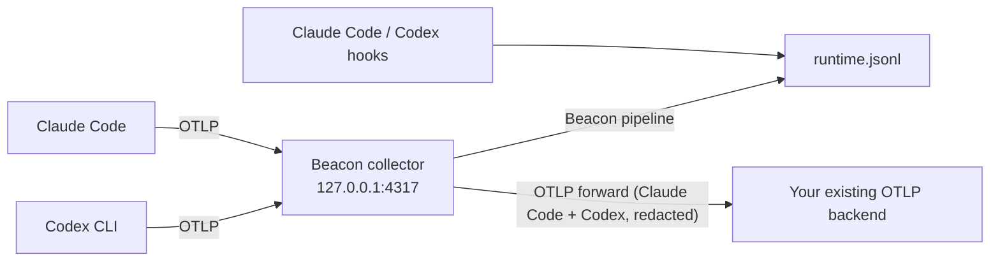

## Overview

Use this runbook when your Macs already send Claude Code and Codex CLI OpenTelemetry (OTLP) to another backend, such as a token-usage or cost platform, and you are adding Beacon with Kandji.

Claude Code and Codex each export OTLP to one endpoint. Beacon needs that export to arrive at its local collector, so installing Beacon points both runtimes at `127.0.0.1:4317`, and the runtimes stop sending to the backend you already had. To keep that backend fed, Beacon's collector **forwards the Claude Code and Codex OTLP it receives to a second OTLP endpoint**, with secrets redacted, alongside writing its own runtime log:



Kandji provides the deployment layer:

| Kandji item | Beacon use |
| --- | --- |
| Custom App (package) | Installs the signed Beacon package, which creates the system endpoint and points Claude Code and Codex at the local collector. |
| Custom App post-install script | Turns on the OTLP forward right after the package installs, so the existing backend misses nothing. |
| Custom Script (audit and remediation) | Re-applies the forward and the runtime settings if they drift, for example after a runtime update rewrites its config or a user logs in for the first time. |

<Info>
  The OTLP forward needs the first Beacon release after v1.3.51. An older package does not have the `--otlp-forward-*` flags, and its collector has no OTLP exporter.
</Info>

## What the existing backend receives

The forward has its own collector pipelines, fed by the same receiver as Beacon's. The backend receives the OTLP logs, metrics and traces Claude Code and Codex send, in OTLP form rather than Beacon's event schema, with three differences from the raw export:

- **Only Claude Code and Codex.** Other OTLP the collector receives stays local: Gemini CLI, VS Code, SDK apps, and Beacon's browser extension, which carries full claude.ai and ChatGPT chats. `--otlp-forward-harness` names a different list.
- **Secrets redacted.** Credentials found in prompts, commands and tool arguments are replaced with `[REDACTED]`, the same redaction Beacon applies before Splunk and Falcon. Token counts, cost, models and session ids are untouched.
- **No raw API bodies.** Claude Code API body events get the same handling as in Beacon's own log.

Hook events and session-file data (`beacon endpoint claude sync`, `codex sync`) never pass through the collector, so the forward does not carry them.

If the backend is down or slow, the forward retries for up to two minutes and holds at most a small queue, then drops what it cannot send. Beacon's local capture never waits on it.

What the runtimes send is set by Beacon's runtime settings, which can differ from the settings you rolled out for the backend. Check these with the backend's owner before rollout:

| Runtime | Beacon setting | Effect on the existing backend |
| --- | --- | --- |
| Claude Code | `OTEL_LOG_USER_PROMPTS=1`, `OTEL_LOG_TOOL_DETAILS=1` | The backend now receives prompt text and tool details (commands, file paths, MCP arguments) if it did not before. |
| Claude Code | `OTEL_EXPORTER_OTLP_METRICS_TEMPORALITY_PREFERENCE=delta` | Metrics such as `claude_code.token.usage` and `claude_code.cost.usage` arrive as per-interval deltas. A backend that expects cumulative counters must accept delta temporality. |
| Claude Code | Logs, metrics and traces all go to the collector over gRPC | Per-signal endpoints and headers from your earlier rollout are overridden, so every signal reaches the backend through the forward. |
| Codex CLI | `[otel]` with a log exporter and a trace exporter, and no metrics exporter | The backend receives Codex logs and the turn traces that carry token usage, and no Codex metrics. |

## Prerequisites

- A signed and notarized `BeaconEndpointAgent-<version>-arm64.pkg`, from the first release after v1.3.51. The endpoint package is for Apple Silicon Macs.
- A pilot Kandji Blueprint, or an assignment rule on a library item, that targets a few Macs with Claude Code or Codex CLI installed.
- The OTLP settings your Macs use for the existing backend today:
  - **Endpoint**: for gRPC, `host:port` or a URL; for HTTP, the base URL without `/v1/logs`.
  - **Protocol**: `grpc` or `http/protobuf`.
  - **Headers**: usually an API key or authorization header, from `OTEL_EXPORTER_OTLP_HEADERS` in Claude Code's settings or `headers` in Codex's `[otel.exporter.*]` table.

<Warning>
  Kandji's documentation covers Custom Apps with pre- and post-install scripts and Custom Scripts with audit and remediation scripts. It does not document how long a Custom App's post-install script may run or whether a remediation script waits for a Custom App. Treat both as pilot acceptance checks in your tenant.
</Warning>

## Step 1: stop the old direct export from fighting Beacon

How you rolled out the existing backend decides what to change. Find the one that matches.

**Claude Code managed settings** (`/Library/Application Support/ClaudeCode/managed-settings.json`, delivered by a Kandji profile or script). Managed settings take precedence over the user's `~/.claude/settings.json`, where Beacon writes its endpoint, so Claude Code would keep exporting straight to the backend and Beacon would get no Claude OTLP. In the managed settings `env`:

- Set `OTEL_EXPORTER_OTLP_ENDPOINT` to `http://127.0.0.1:4317` and `OTEL_EXPORTER_OTLP_PROTOCOL` to `grpc`.
- Remove `OTEL_EXPORTER_OTLP_HEADERS`, every `OTEL_EXPORTER_OTLP_{LOGS,METRICS,TRACES}_ENDPOINT` and `_HEADERS`, and `BETA_TRACING_ENDPOINT`. The backend's credentials move to the forward in Step 3. Left in place, they would be sent to the local collector instead.

**Scripts or profiles that write `~/.claude/settings.json` or `~/.codex/config.toml`.** Beacon rewrites the OTLP settings in both files on every install, upgrade and repair, and replaces Codex's whole `[otel]` table. Retire or unscope the Kandji item that writes the backend's OTLP settings to those files; otherwise it and Beacon overwrite each other on every run.

## Step 2: add the Beacon package as a Custom App

In Kandji, go to **Library**, add a **Custom App**, and:

1. Name it `Beacon Endpoint Agent`.
2. Set the install type to **Package** and upload the Beacon `.pkg`.
3. Choose **Install once per device** (or self-service for the pilot).
4. Leave the pre-install script empty.
5. Paste the post-install script from Step 3.
6. Assign it to the pilot Blueprint.

The package postinstall installs Beacon under `/opt/beacon`, writes the system endpoint configuration, starts `com.beacon.endpoint.collector`, and points the logged-in user's Claude Code and Codex at the collector (`~/.claude/settings.json` and `~/.codex/config.toml`), with Beacon's Claude Code and Codex hooks.

## Step 3: turn on the OTLP forward

Use this script as the Custom App's **post-install script**. Replace the three values at the top with the endpoint, protocol and headers from the prerequisites:

```bash title="Beacon - OTLP forward (post-install script)"
#!/bin/bash
set -euo pipefail

# The existing backend's OTLP settings.
OTLP_FORWARD_ENDPOINT="https://otlp.backend.example:4317"
OTLP_FORWARD_PROTOCOL="grpc"           # or http/protobuf
OTLP_FORWARD_HEADERS=(                 # one name=value per entry; may be empty
  "authorization=Bearer <backend-api-key>"
)

BEACON=/opt/beacon/bin/beacon

args=(endpoint repair --system
  --collector /opt/beacon/bin/beacon-otelcol
  --harness claude,codex
  --otlp-forward-endpoint "$OTLP_FORWARD_ENDPOINT"
  --otlp-forward-protocol "$OTLP_FORWARD_PROTOCOL")
for header in ${OTLP_FORWARD_HEADERS[@]+"${OTLP_FORWARD_HEADERS[@]}"}; do
  args+=(--otlp-forward-header "$header")
done

"$BEACON" "${args[@]}"

# Point the logged-in user's Claude Code and Codex at the collector. This does nothing
# when nobody is logged in; the audit script in Step 4 catches that user later.
"$BEACON" endpoint user-config repair-installed --system --harness claude,codex

"$BEACON" endpoint status --system --json | /usr/bin/grep -q '"otlp_forward":{"configured":true' \
  || "$BEACON" endpoint status --system --json
```

`beacon endpoint repair` stores the forward in `/Library/Application Support/Beacon/Endpoint/config.json` and renders it into the collector config next to it. Header values are usually credentials, so they go to a root-only file beside it, `otlp-forward-headers.json` (`0600`), and into the collector config, which is also `0600`. `config.json` keeps only the header names and stays readable, because the logged-in user's `beacon` commands read it to find the system log. Package upgrades and later repairs keep the forward; you do not pass the flags again. To remove it, run `beacon endpoint repair --system --no-otlp-forward`.

Flags you may also need:

| Flag | Use |
| --- | --- |
| `--otlp-forward-insecure` | The backend takes plaintext gRPC (a collector on your network, for example). |
| `--otlp-forward-ca-file <path>` | The backend's certificate is issued by a private CA. |
| `--otlp-forward-insecure-skip-verify` | Testing only. |

<Note>
  The script holds the backend's API key, and Kandji admins can read Custom App scripts. If that is not acceptable, deliver the key to the Mac another way (for example, a root-only file your secrets tooling writes) and read it into `OTLP_FORWARD_HEADERS` in the script. Beacon never prints header values: `beacon endpoint status` and `beacon endpoint doctor` list header names only.
</Note>

## Step 4: keep it applied with a Custom Script

Add a **Custom Script** library item, set it to **Run every 15 minutes** (or daily once the pilot is stable), and assign it to the same Blueprint.

**Audit script:** exits non-zero, which runs the remediation, when the forward is missing or the logged-in user's runtimes are not pointed at the collector:

```bash title="Beacon - OTLP forward (audit)"
#!/bin/bash
BEACON=/opt/beacon/bin/beacon
[ -x "$BEACON" ] || exit 0   # Beacon not installed yet; the Custom App handles it.

status="$("$BEACON" endpoint status --system --json 2>/dev/null)" || exit 1
echo "$status" | /usr/bin/grep -q '"otlp_forward":{"configured":true' || exit 1

console_user="$(/usr/bin/stat -f %Su /dev/console)"
case "$console_user" in root|loginwindow|_mbsetupuser|"") exit 0 ;; esac
home="$(/usr/bin/dscl . -read "/Users/$console_user" NFSHomeDirectory | /usr/bin/awk '{print $2}')"

if [ -d "$home/.claude" ]; then
  /usr/bin/grep -q '127.0.0.1:4317' "$home/.claude/settings.json" 2>/dev/null || exit 1
fi
if [ -d "$home/.codex" ]; then
  /usr/bin/grep -q '127.0.0.1:4317' "$home/.codex/config.toml" 2>/dev/null || exit 1
fi
exit 0
```

**Remediation script:** the same script as Step 3.

## Validate a pilot Mac

### 1. Collector and forward

```bash
sudo launchctl print system/com.beacon.endpoint.collector | grep -E 'state =|pid ='
sudo /opt/beacon/bin/beacon endpoint status --system --json | grep -o '"otlp_forward":{[^}]*}'
sudo grep -A3 -E '^  otlp(http)?/forward:' "/Library/Application Support/Beacon/Endpoint/otelcol.yaml"
```

Expect a running collector, `"configured": true` with your endpoint and protocol, and an `otlp/forward` (gRPC) or `otlphttp/forward` (HTTP) exporter in the collector config.

### 2. Runtime settings

As the logged-in user:

```bash
grep -n 'OTEL_EXPORTER_OTLP_ENDPOINT\|beacon-hooks' ~/.claude/settings.json
grep -n -A2 '^\[otel' ~/.codex/config.toml
```

Both should point at `127.0.0.1:4317`. If Claude Code has managed settings, check that `/Library/Application Support/ClaudeCode/managed-settings.json` points there too (Step 1).

### 3. Both destinations receive a session

Restart Claude Code and Codex so they read the new settings, then:

```bash
MARKER="beacon kandji fanout $(date +%s)"
claude -p "$MARKER"
codex exec "$MARKER"
sudo grep -c "$MARKER" /var/log/beacon-agent/runtime.jsonl
```

Beacon's runtime log should contain the marker from both runtimes. In the existing backend, confirm that the same sessions appear with token usage from both runtimes in the usual time window.

## Troubleshooting

### The existing backend stopped receiving data

1. Check the forward is configured (validation step 1). If not, run the Step 3 script.
2. Read the collector's log for export errors from the forward:

   ```bash
   sudo grep -i 'forward\|Exporting failed' /Library/Logs/Beacon/com.beacon.endpoint.collector.err | tail -n 20
   ```

   `Unauthenticated` or `401` means a wrong or missing header; `connection refused`, `deadline exceeded` or a TLS error means the endpoint, protocol, or `--otlp-forward-insecure`/`--otlp-forward-ca-file` is wrong. HTTP endpoints take the base URL; the exporter adds `/v1/logs`, `/v1/metrics` and `/v1/traces`.
3. If status shows `"headers_missing": true`, the header values file (`otlp-forward-headers.json`) was removed, for example by a manual cleanup, and the forward is sending without credentials. Run the Step 3 script again.
4. Check that the runtimes still point at the collector (validation step 2). A runtime update or an old Kandji item can rewrite the settings; the Step 4 audit repairs them on its next run.

### `repair` rejects the forward flags

`unknown flag: --otlp-forward-endpoint` means the installed `beacon` predates OTLP forwarding, and `collector ... has no "otlp" exporter` means `beacon-otelcol` does (for example, an older one passed with `--collector`). Deploy the Beacon package from the first release after v1.3.51, then run the Step 3 script again.

### Beacon has no Claude Code OTLP events, but hooks work

Claude Code managed settings still point at the old backend. See Step 1.

### Codex metrics are missing in the backend

Beacon's Codex settings export logs and traces only. Codex token usage reaches the backend in the turn traces. If the backend can only read Codex metrics, contact Asymptote.

## Related

<Columns cols={2}>
  <Card title="beacon endpoint repair" icon="wrench" href="/cli/endpoint-repair">
    Every repair flag, including the OTLP forward.
  </Card>
  <Card title="MDM Deployment" icon="building-shield" href="/mdm">
    Package layout, deployment model and rollback for any MDM.
  </Card>
  <Card title="Claude Code" icon="terminal" href="/runtimes/claude-code">
    Claude Code endpoint telemetry coverage.
  </Card>
  <Card title="Codex CLI" icon="terminal" href="/runtimes/codex-cli">
    Codex CLI endpoint telemetry coverage.
  </Card>
</Columns>
