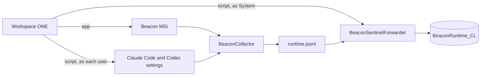

This guide takes you from no Beacon on your Windows machines to every machine in a Workspace ONE pilot sending its AI agent activity to one Microsoft Sentinel table, attributed to the person who ran the agent. Follow the steps in order.

## What you'll set up

When you finish, each machine in the pilot has:

- Beacon installed from the MSI, with its collector running as the `BeaconCollector` Windows service.
- Claude Code and Codex reporting to that collector, for each person who signs in.
- Agent activity written to `C:\ProgramData\Beacon\Endpoint\logs\runtime.jsonl`.
- The `BeaconSentinelForwarder` Windows service (the Vector that ships in the MSI) posting each line to the Azure Monitor Logs Ingestion API.

Those lines land in the custom Log Analytics table `BeaconRuntime_CL`, which Sentinel hunts over. macOS and Linux machines set up the same forwarder with the same command, so every platform fills the same table. See [Microsoft Sentinel forwarding](/log-forwarding/microsoft-sentinel).



## Before you start

| You need | Why |
| --- | --- |
| Workspace ONE UEM, with a pilot smart group of a few Windows x64 machines | Scope the app and scripts before a wider rollout. |
| A Log Analytics workspace with Microsoft Sentinel enabled | Step 1. |
| Permission to deploy a Data Collection Rule and register an app in Microsoft Entra ID | Step 1. The app needs the Monitoring Metrics Publisher role on that rule. |
| A way to make a PFX certificate, such as `openssl` | Step 1. The forwarder authenticates with it. |

The machines do not need Beacon installed beforehand. Workspace ONE installs it in step 2.

## 1. Prepare Sentinel

Do this once, in Azure. The same workspace then receives every machine.

On any machine with Beacon, generate the content pack:

```powershell
beacon endpoint sentinel install-pack --output .\beacon-sentinel-pack
```

Then:

1. **Create the table.** Name it `BeaconRuntime`; Azure adds `_CL`. Upload `sample-event.jsonl` and paste `dcr-transform.kql` in the schema step. The full portal steps are in [Microsoft Sentinel forwarding](/log-forwarding/microsoft-sentinel#3-create-the-beacon-custom-table).
2. **Create the Data Collection Rule.** Deploy `dcr-logs-ingestion-template.json` with the workspace resource ID. Copy the `dcrImmutableId` output (it starts with `dcr-`), then read the rule's logs ingestion URL:

   ```bash
   az monitor data-collection rule show \
     --resource-group <resource group> --name dcr-beacon-runtime-ingestion \
     --query endpoints.logsIngestion --output tsv
   ```

3. **Register an app with a certificate.** Make a certificate and its PFX:

   ```bash
   openssl req -x509 -newkey rsa:2048 -nodes -days 365 \
     -keyout beacon-sentinel.key -out beacon-sentinel.crt -subj '/CN=beacon-sentinel'
   openssl pkcs12 -export -inkey beacon-sentinel.key -in beacon-sentinel.crt \
     -out beacon-sentinel.pfx -passout pass:'<pfx password>'
   ```

   A certificate you already have in a Windows certificate store works too: export it with its private key, as a PFX, with `Export-PfxCertificate` or the Certificates console.

   Register an app in Microsoft Entra ID and upload `beacon-sentinel.crt` under **Certificates & secrets**. Note the tenant ID and the application (client) ID. Keep the PFX and its password for step 2, and delete the key file.
4. **Grant the role.** On the Data Collection Rule, give the app the **Monitoring Metrics Publisher** role. A new assignment can take up to 30 minutes to apply. The forwarder keeps retrying until it does, and loses nothing meanwhile.

Each machine needs outbound HTTPS to `login.microsoftonline.com` and to the rule's `*.ingest.monitor.azure.com` hostname.

## 2. Set up Workspace ONE

Create one app and two scripts, scoped to the pilot smart group:

| Order | What | Runs as | Purpose |
| --- | --- | --- | --- |
| 1 | Beacon MSI (app) | System | Installs Beacon, the collector and Vector |
| 2 | Forward to Sentinel (script) | System | Sets up the `BeaconSentinelForwarder` service |
| 3 | Configure agent tools (script) | Current user, at every sign-in | Points that person's Claude Code and Codex at the collector |

Workspace ONE does not order an app and scripts by itself. Both scripts exit with an error until Beacon is installed, so give them a schedule or a retry, and the app installs first in practice.

If a scheduled task ships the log today, remove it before the forwarder script runs, and add `--read-from end` to the forwarder command, or every line already shipped is sent again.

### App: the Beacon MSI

Download `BeaconEndpointAgent-<version>-x64.msi` and its `.sha256` from the [latest release](https://github.com/asymptote-labs/agent-beacon/releases/latest) and check it:

```powershell
(Get-FileHash BeaconEndpointAgent-<version>-x64.msi -Algorithm SHA256).Hash
```

Add it in Workspace ONE as a Windows app, installed in device context, with:

| Setting | Value |
| --- | --- |
| Install command | `msiexec /i BeaconEndpointAgent-<version>-x64.msi /qn /norestart` |
| Uninstall command | `msiexec /x BeaconEndpointAgent-<version>-x64.msi /qn /norestart` |
| When to call install complete | The app is installed (the MSI's product code) |

Keep `/norestart`. The package never needs a reboot, and without it Windows Installer restarts the machine on its own if something holds a file it has to replace.

To keep users from reading or writing the log themselves, turn on [restricted log access](/security/restricted-log-access#on-windows) in the forwarder script below. The forwarder works the same either way.

The installer and its programs are not code-signed yet. If you run AppLocker or WDAC, allow by path or file hash:

- the MSI itself;
- `beacon.exe`, `beacon-hooks.exe`, `beacon-otelcol.exe` and `vector.exe` in `C:\Program Files\Beacon\bin`;
- the package's PowerShell scripts in `C:\Program Files\Beacon\scripts`, which the MSI runs as SYSTEM;
- the copy of the hook program agents run from each profile, `%USERPROFILE%\.beacon\endpoint\hooks\beacon-hooks.exe`;
- the two scripts in this guide.

**Success looks like:** `sc.exe query BeaconCollector` reports `RUNNING`. With restricted log access turned on, `beacon.exe endpoint status --system --json` also reports `"log_access": "restricted"`.

### Script: forward to Sentinel

Add a PowerShell script that runs as **System**, after the app. Give it these variables, and mark the PFX and its password as secure. Workspace ONE passes script variables to the script as environment variables.

| Variable | Value |
| --- | --- |
| `BEACON_SENTINEL_ENDPOINT` | The logs ingestion URL from step 1 |
| `BEACON_SENTINEL_DCR_ID` | The `dcr-...` immutable ID |
| `BEACON_SENTINEL_TENANT_ID` | The tenant ID |
| `BEACON_SENTINEL_CLIENT_ID` | The app's client ID |
| `BEACON_SENTINEL_PFX_BASE64` | The PFX, base64-encoded (`[Convert]::ToBase64String([IO.File]::ReadAllBytes((Resolve-Path 'beacon-sentinel.pfx')))`) |
| `BEACON_SENTINEL_PFX_PASSWORD` | The PFX password |

```powershell title="Forward to Sentinel"
$ErrorActionPreference = 'Stop'
$beacon = Join-Path $env:ProgramFiles 'Beacon\bin\beacon.exe'
if (-not (Test-Path -LiteralPath $beacon)) { Write-Error 'Beacon is not installed yet'; exit 1 }
# Optional: keep users from reading or writing the runtime log.
# & $beacon endpoint repair --system --log-access restricted
$pfx = Join-Path $env:SystemRoot ('Temp\beacon-sentinel-' + [Guid]::NewGuid().ToString('N') + '.pfx')
[IO.File]::WriteAllBytes($pfx, [Convert]::FromBase64String($env:BEACON_SENTINEL_PFX_BASE64))
try {
    $env:AZURE_CLIENT_CERTIFICATE_PASSWORD = $env:BEACON_SENTINEL_PFX_PASSWORD
    & $beacon endpoint sentinel forwarder install --system `
        --endpoint $env:BEACON_SENTINEL_ENDPOINT `
        --dcr-immutable-id $env:BEACON_SENTINEL_DCR_ID `
        --tenant-id $env:BEACON_SENTINEL_TENANT_ID `
        --client-id $env:BEACON_SENTINEL_CLIENT_ID `
        --client-certificate $pfx
    exit $LASTEXITCODE
} finally {
    Remove-Item -LiteralPath $pfx -Force -ErrorAction SilentlyContinue
}
```

The command copies the certificate and its password into `C:\ProgramData\Beacon\Endpoint\forwarders\sentinel`, which only SYSTEM and Administrators can read, so the script deletes its own copy. It has Vector check the config before changing anything, and then starts the service. On its first start the forwarder sends what is already in the log once, including the past sessions the install picked up, and then each new line.

Running the script again replaces the settings, which is how you rotate the certificate.

**Success looks like:** the script exits 0, and `sc.exe query BeaconSentinelForwarder` reports `RUNNING`.

### Script: configure agent tools

Add a PowerShell script that runs as the **current user**, with the **Login** trigger, so it runs for each person who signs in, including people who were not signed in when it was first deployed:

```powershell title="Configure agent tools"
$beacon = Join-Path $env:ProgramFiles 'Beacon\bin\beacon.exe'
if (-not (Test-Path -LiteralPath $beacon)) { Write-Error 'Beacon is not installed yet'; exit 1 }
& $beacon endpoint user-config repair-installed --system --harness claude,codex
exit $LASTEXITCODE
```

It points that person's Claude Code and Codex at the collector and installs their hooks. The hooks run as that person, so their events carry the person's Windows account (their SID), which is how every event is attributed on a machine several people use. See step 3.

**Success looks like:** the script exits 0, and `%USERPROFILE%\.claude\settings.json` contains `OTEL_EXPORTER_OTLP_ENDPOINT` and Beacon's hooks.

## 3. Check one machine

From an elevated PowerShell on a pilot machine:

```powershell
$beacon = Join-Path $env:ProgramFiles 'Beacon\bin\beacon.exe'
& $beacon endpoint sentinel forwarder status --system
& $beacon endpoint sentinel validate --system
```

`status` shows the service state and Vector's latest warning, if it has one. `validate` writes a test event. Within a minute or two it is in Log Analytics:

```kql
BeaconRuntime_CL
| where TimeGenerated > ago(1h)
| where Message has "Beacon endpoint Sentinel validation event"
```

Then have someone run Claude Code and check whose sessions arrived. Hook events carry the person's account. Claude Code's and Codex's own OpenTelemetry events (token usage, cost, API requests) carry the collector's own account, the machine account `COMPUTERNAME$`, because every account sends to the same local port, but they share the session's id, so the join below names the person behind every event:

```kql
let owners = BeaconRuntime_CL
    | where isnotempty(SessionId) and tostring(RawData.harness.collection_method) in ("hook", "plugin")
    | summarize OwnerId = take_any(tostring(RawData.user.uid)), Owner = take_any(tostring(RawData.user.name)) by HostName, SessionId;
BeaconRuntime_CL
| where TimeGenerated > ago(1h) and isnotempty(SessionId)
| join kind=leftouter owners on HostName, SessionId
| extend UserId = coalesce(OwnerId, tostring(RawData.user.uid)), User = coalesce(Owner, tostring(RawData.user.name))
| summarize Events = count() by HostName, User, UserId, HarnessName
```

See [Who ran each session](/log-forwarding/microsoft-sentinel#who-ran-each-session) for more.

## Upgrades and removal

- **Upgrade:** add the newer MSI with the same install command. The forwarder keeps its settings and credential, and the upgrade restarts it on the new Vector.
- **Uninstall:** removes both services. The settings stay in `C:\ProgramData\Beacon\Endpoint`, so reinstalling brings the forwarder back. To remove those too, follow [Uninstall](/platforms/windows#uninstall) with `BEACON_PURGE=1`.
- **Remove only the forwarder:** `beacon.exe endpoint sentinel forwarder remove --system`.

## Troubleshooting

| What you see | Likely cause |
| --- | --- |
| The forwarder script fails with "PKCS12 parsing failed" | The PFX password is wrong. Check `BEACON_SENTINEL_PFX_PASSWORD`. |
| `status` reports `Retrying after response` with 403 | The role assignment has not applied yet. Wait up to 30 minutes; nothing is lost meanwhile. |
| `status` reports an `AADSTS` error | Entra ID refused the credential: a wrong tenant or client ID, or a certificate that was not uploaded to the app, has expired or was removed. Vector drops what it cannot send while this lasts, so renew certificates before they expire and rerun the forwarder script with the new one. |
| Events arrive under the machine account (`COMPUTERNAME$`) | Agents' own OpenTelemetry events always do; attribute them with the join in step 3. If a session has no hook events at all, the person's agent-tools script has not run yet (check its Login trigger). |
| An app, script or hook is blocked | AppLocker or WDAC; allow everything listed under the app above. |

## Related

<Columns cols={2}>
  <Card title="Microsoft Sentinel forwarding" icon="tower-broadcast" href="/log-forwarding/microsoft-sentinel">
    Both ingestion paths, the table, and hunting content.
  </Card>
  <Card title="Windows install" icon="windows" href="/platforms/windows">
    The MSI, the service, and how upgrades and uninstall work.
  </Card>
  <Card title="beacon endpoint sentinel" icon="terminal" href="/cli/sentinel">
    Every forwarder command and flag.
  </Card>
  <Card title="Restricted log access" icon="lock" href="/security/restricted-log-access">
    Keep users from reading or writing the runtime log.
  </Card>
</Columns>
