## Forwarding overview

Beacon `v0.0.32` added the [Microsoft Sentinel content pack](/concepts/core-concepts#microsoft-sentinel-content-pack) for teams that want Beacon endpoint events in Log Analytics and Sentinel hunting workflows. Beacon remains the local JSONL producer and writes one source of truth, the active [runtime JSONL log](/concepts/core-concepts#runtime-jsonl-log). Something on the host tails that file and sends new records through a Data Collection Rule (DCR) into a custom Log Analytics table. There are two ways to do that, and both fill the same `BeaconRuntime_CL` table through the same transform:

| Path | Runs on the host | Needs |
|---|---|---|
| Azure Monitor Agent | AMA | An Azure VM, or [Azure Arc](#azure-monitor-agent-outside-azure) on any other machine |
| Vector | The Vector that ships with Beacon | A Microsoft Entra app registration. No Arc and no agent extension. See [Vector and the Logs Ingestion API](#vector-and-the-logs-ingestion-api) |

On a desktop or server outside Azure, the Vector path is usually simpler.

Beacon's `config.json` never holds Azure values. On the Vector path, the forwarder keeps its settings and credential in a directory only root can read (SYSTEM and Administrators on Windows).

## Runtime log paths

| Mode | Runtime log |
|------|-------------|
| User mode | `~/.beacon/endpoint/logs/runtime.jsonl` |
| System mode, macOS and Linux | `/var/log/beacon-agent/runtime.jsonl` |
| System mode, Windows | `C:\ProgramData\Beacon\Endpoint\logs\runtime.jsonl` |

Use system mode for MDM deployments so Azure Monitor Agent can tail `/var/log/beacon-agent/runtime.jsonl` without per-user home directory permissions.

## Prerequisites

- Beacon endpoint installed and writing local JSONL.
- A Log Analytics workspace, with Microsoft Sentinel enabled if you want Sentinel hunting and analytics workflows.
- A custom Log Analytics table named `BeaconRuntime_CL`.
- For the Azure Monitor Agent path: AMA on the endpoint (Azure Arc first, outside Azure) and a DCR associated with it.
- For the Vector path: an Entra app registration and the Logs Ingestion DCR from the pack, and a system install of Beacon.

## Install the Sentinel pack

Generate the Sentinel content pack for a managed system-mode deployment:

```bash title="Generate the Sentinel content pack for a managed system-mode deployment"
sudo /opt/beacon/bin/beacon endpoint sentinel install-pack \
  --system \
  --output ./beacon-sentinel-pack
```

The pack includes:

- `README.md` with setup and validation steps
- `table-schema.json` for the `BeaconRuntime_CL` custom table
- `dcr-template.json` for Azure Monitor Agent custom text log collection
- `dcr-logs-ingestion-template.json` and `vector.toml` for the Vector path
- `dcr-transform.kql` for parsing each Beacon JSONL line
- `queries.kql` with validation and starter hunting queries
- `detections.kql` with example analytics rule logic
- `sample-event.jsonl` with Beacon endpoint sample events

If you use a custom Beacon log path, generate the pack with `--log-path /path/to/runtime.jsonl`. The generated DCR template uses the selected path.

## Sentinel setup

Set up Microsoft Sentinel ingestion from the Azure Portal. If Sentinel is already enabled for your Log Analytics workspace, skip the Sentinel enablement step.

```mermaid
flowchart LR
  agentHarnesses["Agent harnesses"] -->|"OTLP or hooks"| beaconEndpoint["Beacon endpoint agent"]
  beaconEndpoint -->|"writes normalized events"| runtimeLog["runtime.jsonl"]
  runtimeLog -->|"custom text logs"| azureMonitorAgent["Azure Monitor Agent"]
  azureMonitorAgent -->|"DCR transform"| logAnalytics["BeaconRuntime_CL"]
  logAnalytics -->|"queries and analytics rules"| sentinel["Microsoft Sentinel"]
```



### 1. Enable Sentinel if needed

If the workspace does not already have Microsoft Sentinel enabled, open the Azure Portal, search for **Microsoft Sentinel**, click **Create**, select the `agent-beacon-instance` workspace, and click **Add**. Sentinel uses that Log Analytics workspace as its backend.

<Frame caption="Select the Log Analytics workspace to add to Microsoft Sentinel.">
  
</Frame>

### 2. Create the Data Collection Endpoint

Create a Data Collection Endpoint in the same region as the Log Analytics workspace. For the example workspace shown here, use:

| Field | Value |
|-------|-------|
| Name | `dce-agent-beacon-runtime` |
| Resource group | `agent-beacon` |
| Region | `East US` |

If Azure says no Data Collection Endpoint exists during the custom log wizard, create this endpoint first, then return to the wizard.

<Frame caption="Open Data collection endpoints and create a new endpoint if none exists.">
  
</Frame>

<Frame caption="Create the Beacon Data Collection Endpoint in the workspace region.">
  
</Frame>

### 3. Create the Beacon custom table

Open your Log Analytics workspace, such as `agent-beacon-instance`, then go to **Settings** > **Tables**. If you do not see **Tables**, use the search box inside the workspace left navigation and search for **Tables**.

Click **Create** > **New custom log (DCR-based)**. Use:

| Field | Value |
|-------|-------|
| Table name | `BeaconRuntime` |
| Description | `Agent Beacon endpoint runtime telemetry` |
| Table plan | `Analytics` |
| Data collection rule | `dcr-agent-beacon-runtime` |
| Data collection endpoint | `dce-agent-beacon-runtime` |

Enter the table name as `BeaconRuntime`, not `BeaconRuntime_CL`. Azure adds the `_CL` suffix automatically, so the final Log Analytics table is `BeaconRuntime_CL`. If you enter `BeaconRuntime_CL`, Azure may create `BeaconRuntime_CL_CL`.

<Frame caption="Open the Tables page in the Log Analytics workspace.">
  
</Frame>

<Frame caption="Create the Beacon custom log table and Data Collection Rule.">
  
</Frame>

### 4. Configure schema and transformation

In the **Schema and transformation** step, upload `sample-event.jsonl` from the generated Sentinel pack. Do not paste `table-schema.json` into the portal wizard; use it as the reference for the expected columns.

Paste the contents of `dcr-transform.kql` into the transformation editor and confirm the output columns match the `table-schema.json` schema. The key columns are:

| Column | Column | Column |
|--------|--------|--------|
| `TimeGenerated` | `Vendor` | `Product` |
| `SchemaVersion` | `EventKind` | `EventAction` |
| `EventCategory` | `Severity` | `HostName` |
| `UserName` | `HarnessName` | `SessionId` |
| `ToolName` | `CommandLine` | `Repository` |
| `Branch` | `Message` | `ContentRetention` |
| `RawData` | | |

The DCR uses Custom Text Logs because Beacon writes newline-delimited JSON. The transform parses each `RawData` line with `todynamic(RawData)`, projects common hunting columns, preserves the original Beacon event in `RawData`, and routes output to `BeaconRuntime_CL`.

### 5. Choose the ingestion path

Azure Monitor Agent does not run on macOS, so Macs use the [Vector path](#vector-and-the-logs-ingestion-api). The signed macOS package installs Vector at `/opt/beacon/bin/vector`, just like the Linux packages.

For Azure Monitor Agent on Windows or Linux, install AMA on the machine, add a custom text log source pointing at the Beacon runtime log (usually `/var/log/beacon-agent/runtime.jsonl`), apply the Beacon DCR transform, route output to `BeaconRuntime_CL`, and associate the DCR with the machine. On an endpoint with [restricted log access](/security/restricted-log-access), AMA can read the log only if it runs as root (SYSTEM on Windows, its default) or its account is in the `beacon-log` group.

### Azure Monitor Agent outside Azure

AMA is an Azure VM extension. On a machine that is not an Azure VM, you have to onboard it to [Azure Arc](https://learn.microsoft.com/en-us/azure/azure-arc/servers/overview) (`azcmagent connect`) before AMA can be installed. That makes every endpoint an Azure resource, running the Connected Machine agent next to AMA. The DCE's logs ingestion endpoint must be in the workspace's region.

A host that cannot reach Azure at all cannot use either path.

## Vector and the Logs Ingestion API

Vector reads `runtime.jsonl` and posts each line to the [Logs Ingestion API](https://learn.microsoft.com/en-us/azure/azure-monitor/logs/logs-ingestion-api-overview) with a Microsoft Entra app registration. It needs no Arc, no AMA, and no Azure resource per machine. Vector ships with Beacon on all three platforms: the macOS package and the Linux `.deb` and `.rpm` install it at `/opt/beacon/bin/vector`, and the Windows MSI installs `vector.exe` beside `beacon.exe`. `beacon endpoint sentinel forwarder install` runs it as a system service, so one command sets up forwarding the same way on every machine.

Each record carries the original Beacon line as `RawData`. The Logs Ingestion DCR runs the same transform as the AMA path, so the rows are identical either way.

### 1. Azure side, once

1. Create the `BeaconRuntime_CL` table as in step 3 above.
2. Deploy `dcr-logs-ingestion-template.json` from the pack with the workspace resource ID, and note the `dcrImmutableId` output. Then read the DCR's logs ingestion URL:

   ```bash title="Read the DCR's logs ingestion URL"
   az monitor data-collection rule show \
     --resource-group <resource group> --name dcr-beacon-runtime-ingestion \
     --query endpoints.logsIngestion --output tsv
   ```

   You need a Data Collection Endpoint only for Private Link. Pass its resource ID as `dataCollectionEndpointResourceId` and use its logs ingestion URL instead.
3. Register an app in Microsoft Entra ID and give it a certificate. A client secret also works, but Microsoft recommends a certificate for production.
4. On the DCR, grant the app the **Monitoring Metrics Publisher** role. A new role assignment can take up to 30 minutes to apply; the forwarder keeps retrying until it does.

### 2. Each host

Run this as root, or from an elevated shell on Windows. A fleet tool running as `LocalSystem` works too.

<CodeGroup>
```bash title="macOS and Linux"
sudo AZURE_CLIENT_CERTIFICATE_PASSWORD='<pfx password>' \
  /opt/beacon/bin/beacon endpoint sentinel forwarder install --system \
  --endpoint https://<dcr>.<region>-1.ingest.monitor.azure.com \
  --dcr-immutable-id dcr-<32 hex digits> \
  --tenant-id <tenant ID> --client-id <app ID> \
  --client-certificate /path/to/app.pfx
```

```powershell title="Windows"
$env:AZURE_CLIENT_CERTIFICATE_PASSWORD = '<pfx password>'
& "$env:ProgramFiles\Beacon\bin\beacon.exe" endpoint sentinel forwarder install --system `
  --endpoint https://<dcr>.<region>-1.ingest.monitor.azure.com `
  --dcr-immutable-id dcr-<32 hex digits> `
  --tenant-id <tenant ID> --client-id <app ID> `
  --client-certificate C:\path\to\app.pfx
```
</CodeGroup>

Leave out the password variable for a certificate without one. To use a client secret instead of a certificate, drop `--client-certificate` and pass the secret on stdin with `--client-secret-stdin`, or in `AZURE_CLIENT_SECRET`. The credential is never a command-line argument.

The command:

1. Copies the certificate, its password or the secret into `forwarders/sentinel` under the endpoint's system directory (`/etc/beacon/endpoint` on Linux, `/Library/Application Support/Beacon/Endpoint` on macOS, `C:\ProgramData\Beacon\Endpoint` on Windows). Only root can read that directory, or SYSTEM and Administrators on Windows. You can delete your own copy of the certificate afterwards.
2. Writes Vector's config with the values in it and has Vector check it. If Vector rejects it, nothing changes, and a forwarder that was already running keeps running as it was.
3. Starts Vector as a service that restarts on failure and after a reboot: `BeaconSentinelForwarder` on Windows, `beacon-sentinel-forwarder.service` on Linux, and `com.beacon.endpoint.sentinel-forwarder` on macOS.

On its first start the forwarder sends the current runtime log once, including the sessions the install backfilled, then only new lines. Pass `--read-from end` to skip what is already in the log.

The host needs outbound HTTPS to `login.microsoftonline.com` and to the DCR's `*.ingest.monitor.azure.com` hostname. For Azure Government or another sovereign cloud, pass its Entra authority with `--authority-host`, such as `https://login.microsoftonline.us`.

### Operate the forwarder

```bash title="Check it"
sudo /opt/beacon/bin/beacon endpoint sentinel forwarder status --system
```

`beacon endpoint status --system` shows the same service state. Vector's own warnings and errors are in `forwarders/sentinel/logs/vector-<date>.log` under the endpoint's system directory; install, repair and upgrades delete files over a week old.

- To change a setting or rotate the credential, run `forwarder install` again with the new values.
- Repair and package upgrades keep the forwarder. An upgrade restarts it on the new package's Vector.
- Uninstall removes the service. A non-purge uninstall (`--keep-config`, or a Windows MSI removal without `BEACON_PURGE=1`) keeps its settings, so installing Beacon again brings it back. `beacon endpoint sentinel forwarder remove --system` deletes the settings and credential too.
- With [restricted log access](/security/restricted-log-access), nothing changes: the forwarder runs as root or SYSTEM and can read the log.

Vector saves its place in the log only after Azure has accepted a batch, and retries throttling, server errors and `401`/`403` answers without a limit. An outage or a role assignment that has not applied yet holds lines back rather than dropping them. After a crash some lines can be sent twice. Every row's `RawData` carries the event's `event.id`, so you can remove duplicates in a query.

One case is not retried. When Microsoft Entra ID refuses the credential itself, because the tenant or client ID is wrong or the certificate or secret has expired or been removed, Vector drops the batches it cannot get a token for, and `status` shows Entra's error. Lines written while the credential is refused are not sent. Renew the certificate or secret before it expires, and run `forwarder install` again with the new one.

### Run Vector yourself

`vector.toml` in the pack is the same config for running Vector under your own service manager, with the values taken from its environment: `BEACON_SENTINEL_DCE_ENDPOINT` (the logs ingestion URL), `BEACON_SENTINEL_DCR_IMMUTABLE_ID`, `AZURE_TENANT_ID`, `AZURE_CLIENT_ID` and `AZURE_CLIENT_SECRET`. If you already run it that way, stop that service before you install the managed forwarder, or every line is sent twice.

### Who ran each session

On a machine several people use, the person behind an event is in `RawData.user`: `uid` is the account's uid, or its SID on Windows, and `name` its name. Hook and plugin events carry it, because each hook and plugin runs as the person who ran the agent; with [restricted log access](/security/restricted-log-access) the operating system vouches for it. Events from an agent's own OpenTelemetry export, such as Claude Code's token usage and cost, carry the collector's own account instead (such as `root`, or the machine account `COMPUTERNAME$` on Windows), because every account sends to the same local port. Claude Cowork is the exception: its events name the cloud account it reports. Both kinds share the session's id, so take the person from the hook and plugin events, and keep an event's own user where its session has none:

```kql title="Attribute every event to the person who ran its session"
let owners = BeaconRuntime_CL
    | where isnotempty(SessionId) and tostring(RawData.harness.collection_method) in ("hook", "plugin")
    | summarize OwnerId = take_any(tostring(RawData.user.uid)), Owner = take_any(tostring(RawData.user.name)) by HostName, SessionId;
BeaconRuntime_CL
| where isnotempty(SessionId)
| join kind=leftouter owners on HostName, SessionId
| extend UserId = coalesce(OwnerId, tostring(RawData.user.uid)), User = coalesce(Owner, tostring(RawData.user.name))
| summarize Events = count() by HostName, User, UserId, HarnessName
```

Claude Code's events also carry the Anthropic account the person signed in with, in `RawData.raw.attributes["user.email"]` and `["user.account_uuid"]`. That names the Claude account rather than the operating system login.

The generated table schema includes columns such as `Vendor`, `Product`, `EventAction`, `Severity`, `HostName`, `UserName`, `HarnessName`, `SessionId`, `ToolName`, `CommandLine`, `Repository`, `Branch`, `Message`, and `RawData`.

## Validate forwarding

Confirm the Beacon runtime log exists and has recent endpoint events:

```bash title="Confirm the Beacon runtime log exists and has recent endpoint events"
sudo /opt/beacon/bin/beacon endpoint status --system --json
sudo test -r /var/log/beacon-agent/runtime.jsonl
```

Write a Sentinel validation event:

```bash title="Write a Sentinel validation event"
sudo /opt/beacon/bin/beacon endpoint sentinel validate --system
```

After Azure Monitor Agent ships the new line, validate in Microsoft Sentinel or Log Analytics:

```kql
BeaconRuntime_CL
| where TimeGenerated > ago(24h)
| where Message has "Beacon endpoint Sentinel validation event"
| order by TimeGenerated desc
```

If the validation query does not return data, check the DCR association, Azure Monitor Agent health state, configured file path, and table schema. On the Vector path, run `beacon endpoint sentinel forwarder status --system`, which shows Vector's last warning, and confirm the app has Monitoring Metrics Publisher on the DCR. Role assignments can take several minutes to apply. The target table must exist before the DCR can route transformed records to it.

## Hunting content

Use `queries.kql` for validation and starter hunting queries, including recent Beacon events, command execution, sensitive file edits, high tool-call volume, and new or rare agent runtimes.

Use `detections.kql` as example analytics rule logic. Review and tune thresholds, repository names, content handling policy, and severity mappings before enabling alerts in production.

## CEF, syslog, and direct APIs

Microsoft Sentinel can also collect CEF and Syslog through Azure Monitor Agent, but the generated Beacon pack uses custom logs because Beacon events are rich structured JSON with prompts, tool calls, commands, files, runtime metadata, and optional raw fields. Flattening those events into CEF loses useful context.

Beacon's `config.json` never holds Azure values. The managed forwarder keeps its settings and credential in its own directory, readable only by root, or by SYSTEM and Administrators on Windows. Vector does the batching and retries.

## Content handling

Beacon applies redaction, sanitization, truncation, and event-size limits before events are written to `runtime.jsonl` and forwarded to Microsoft Sentinel. Review workspace access, table retention, analytics rules, and downstream consumers so retained telemetry matches your approved collection policy.

## Related

<Columns cols={2}>
  <Card title="Jamf and Sentinel" icon="screwdriver-wrench" href="/guides/jamf-sentinel-mdm">
    Roll Beacon out to Macs with Jamf Pro and forward runtime events to Sentinel.
  </Card>
  <Card title="Workspace ONE and Sentinel" icon="windows" href="/guides/workspace-one-sentinel-mdm">
    Roll Beacon out to Windows machines with Workspace ONE and forward runtime events to Sentinel.
  </Card>
  <Card title="beacon endpoint sentinel" icon="terminal" href="/cli/sentinel">
    Review Microsoft Sentinel command syntax, flags, and examples.
  </Card>
  <Card title="Log forwarding" icon="tower-broadcast" href="/log-forwarding">
    Review forwarding patterns across Wazuh, Splunk HEC, Falcon LogScale, Elastic, Datadog, Sumo Logic, Rapid7, Microsoft Sentinel, and customer-managed pipelines.
  </Card>
  <Card title="Endpoint event schema" icon="code" href="/telemetry-schema/event-schema">
    Review normalized Beacon JSONL fields and example events.
  </Card>
  <Card title="Agent harness integrations" icon="list-check" href="/runtimes">
    Review supported agent harnesses, deployment modes, storage, and forwarding.
  </Card>
</Columns>
