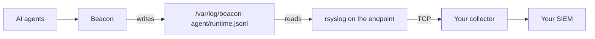

If your Linux endpoints already send logs through rsyslog to an internal collector, Beacon can use the same path. One rsyslog file on each endpoint reads Beacon's local event log and forwards every event to your collector over TCP. Your collector then passes the events on to your SIEM, such as Microsoft Sentinel, the way it handles your other logs.

The endpoints need no connection to your SIEM and no extra agent. Your existing rsyslog forwarding is not changed.



## Before you start

- Linux endpoints running rsyslog 8, the default on Ubuntu, Debian, RHEL, Rocky, and Alma.
- A collector that accepts syslog over TCP, and its hostname and port.

Beacon events can be up to 64 KB. UDP cannot carry messages that large, so this path uses TCP even if your other logs go over UDP.

## 1. Install Beacon on each endpoint

Run the block for your distribution. It downloads the latest package for the endpoint's architecture, checks it against the published checksums, and installs it.

<CodeGroup>
```bash title="Debian, Ubuntu"
VERSION="$(curl -fsSLI -o /dev/null -w '%{url_effective}' https://github.com/asymptote-labs/agent-beacon/releases/latest)"; VERSION="${VERSION##*/v}"
PKG="beacon_${VERSION}_linux_$(dpkg --print-architecture).deb"
BASE="https://github.com/asymptote-labs/agent-beacon/releases/download/v${VERSION}"
curl -fsSLO "${BASE}/${PKG}" && curl -fsSLO "${BASE}/checksums.txt"
grep "  ${PKG}$" checksums.txt | sha256sum --check - && sudo apt install "./${PKG}"
```

```bash title="Fedora, RHEL, Rocky, Alma"
VERSION="$(curl -fsSLI -o /dev/null -w '%{url_effective}' https://github.com/asymptote-labs/agent-beacon/releases/latest)"; VERSION="${VERSION##*/v}"
case "$(uname -m)" in x86_64) ARCH=amd64 ;; aarch64) ARCH=arm64 ;; esac
PKG="beacon_${VERSION}_linux_${ARCH}.rpm"
BASE="https://github.com/asymptote-labs/agent-beacon/releases/download/v${VERSION}"
curl -fsSLO "${BASE}/${PKG}" && curl -fsSLO "${BASE}/checksums.txt"
grep "  ${PKG}$" checksums.txt | sha256sum --check - && sudo dnf install "./${PKG}"
```
</CodeGroup>

Check it:

```bash
beacon endpoint status --system
```

`running=true` and `telemetry=enabled` mean Beacon is recording. It writes one JSON object per line to `/var/log/beacon-agent/runtime.jsonl`. See [Linux install](/platforms/linux) for what the package sets up.

## 2. Configure the collector

The collector has to accept syslog over TCP and messages up to 128 KB. If it is rsyslog, add this to its configuration and restart it:

```text title="/etc/rsyslog.d/10-beacon-input.conf on the collector"
# Accept syslog over TCP, with messages up to 128 KB.
global(maxMessageSize="128k")
module(load="imtcp")
input(type="imtcp" port="514")
```

If your collector already has a TCP input, keep it and raise its maximum message size to 128 KB. For a collector that is not rsyslog, set the equivalent: a TCP syslog input with newline-separated messages and a maximum message size of at least 128 KB. A smaller limit cuts large events off, and a cut-off event is no longer valid JSON.

## 3. Add the forwarding file to each endpoint

Save this as `/etc/rsyslog.d/60-beacon.conf`, replacing `collector.example.internal` and `514` with your collector's hostname and TCP port:

```text title="/etc/rsyslog.d/60-beacon.conf"
# /etc/rsyslog.d/60-beacon.conf
# Forwards Beacon endpoint events to your collector over TCP.

# Beacon events can be up to 64 KB. rsyslog's default limit is 8 KB.
global(maxMessageSize="128k")

module(load="imfile")

input(type="imfile"
      File="/var/log/beacon-agent/runtime.jsonl"
      Tag="beacon:"
      Ruleset="beacon")

ruleset(name="beacon") {
  action(type="omfwd"
         Target="collector.example.internal"
         Port="514"
         Protocol="tcp"
         queue.type="LinkedList"
         queue.filename="beacon-forward"
         queue.maxDiskSpace="1g"
         queue.saveOnShutdown="on"
         action.resumeRetryCount="-1"
         action.resumeInterval="10")
}
```

This file:

- Reads Beacon's log and keeps up with it when Beacon rotates it.
- Sends only Beacon's events, each tagged `beacon`, over their own TCP connection. They do not go to `/var/log/syslog` or to your existing forwarding.
- Queues events on disk, up to 1 GB, while the collector is unreachable, and sends them when it comes back.

Check the configuration, then restart rsyslog:

```bash
sudo rsyslogd -N1
sudo systemctl restart rsyslog
```

`rsyslogd -N1` should end with `End of config validation run` and print no errors. If it reports one of these, your rsyslog configuration already has the setting:

| Error | Fix |
|---|---|
| `module 'imfile' already in this config` | Delete the `module(load="imfile")` line from `60-beacon.conf`. |
| `parameter 'maxmessagesize' specified more than once` | Delete the `global(...)` line from `60-beacon.conf` and raise your existing setting to `128k`. rsyslog keeps the first value it reads, so leaving the smaller one in place cuts large events off. |

### Deploy with Salt

The file is the same on every endpoint, so Salt only needs to place it and restart rsyslog when it changes:

```yaml title="beacon/rsyslog.sls"
beacon-rsyslog-forwarding:
  file.managed:
    - name: /etc/rsyslog.d/60-beacon.conf
    - source: salt://beacon/60-beacon.conf
    - user: root
    - group: root
    - mode: '0644'

rsyslog:
  service.running:
    - enable: True
    - watch:
      - file: beacon-rsyslog-forwarding
```

### With restricted log access

If the endpoint uses [restricted log access](/security/restricted-log-access), only root and members of the `beacon-log` group can read `runtime.jsonl`. rsyslog reads the log as the account it runs under, so that account has to be able to read it. To see which account that is, run:

```bash
ps -o user= -C rsyslogd
```

- **`root`** (RHEL, Rocky Linux, AlmaLinux, Debian and most other distributions): nothing to change.
- **`syslog`** (Ubuntu, whose rsyslog package sets `$PrivDropToUser syslog` in `/etc/rsyslog.conf`): add `syslog` to `beacon-log`, then restart rsyslog so it picks up the new group:

```bash
sudo usermod -aG beacon-log syslog
sudo systemctl restart rsyslog
```

Without this, rsyslog on Ubuntu cannot open the log and no Beacon events reach your collector. To check, run:

```bash
sudo -u syslog test -r /var/log/beacon-agent/runtime.jsonl && echo readable
```

With Salt, add the membership to the same state, limited to Ubuntu endpoints that use restricted log access. Other systems have no `syslog` account, so the membership would fail there. The `beacon-log` group exists once Beacon is installed with restricted log access, so apply this state after that:

```yaml title="beacon/rsyslog.sls"

rsyslog-reads-beacon-log:
  group.present:
    - name: beacon-log
    - addusers:
      - syslog
    - watch_in:
      - service: rsyslog

```

The `.beacon-log-access` file is the marker Beacon writes beside the log when restricted log access is on.

## 4. Confirm events arrive

On an endpoint, write a test event:

```bash
sudo beacon endpoint test-event --system
```

Within a few seconds your collector receives a message tagged `beacon`. Its body is one JSON event whose `message` field is `Beacon endpoint pipeline validation event`. Search your collector or SIEM for that text.

The first time rsyslog starts with this file, it also sends the events already in the log. After that it sends only new ones.

## What gets sent

Each message is one Beacon event, unchanged, as a single line of JSON. Events can include prompt text, commands the agent ran, file paths, and tool input, after Beacon's redaction and its 64 KB per-event limit. See [Retention and redaction](/security/retention-redaction) to control what Beacon keeps, and the [event schema](/telemetry-schema/event-schema) for the fields.

rsyslog sends the events with facility `local0` and severity `notice`. To change them, add `Facility="..."` and `Severity="..."` to the `input(...)` block.

## If events do not arrive

- Run `sudo rsyslogd -N1` again and fix any error it prints.
- Check `sudo journalctl -u rsyslog` for connection errors, and that the endpoint can reach the collector's TCP port.
- On RHEL-family endpoints with SELinux enforcing, rsyslog may be denied the collector's port. If the audit log shows a denial, allow the port with `sudo semanage port -a -t syslogd_port_t -p tcp <port>`.
- If large events arrive cut off, raise the collector's maximum message size to 128 KB.
- If the endpoint uses restricted log access, check that rsyslog's account can read the log. See [With restricted log access](#with-restricted-log-access).

## Related

<Columns cols={2}>
  <Card title="Linux install" icon="linux" href="/platforms/linux">
    What the package installs and how the service runs.
  </Card>
  <Card title="Microsoft Sentinel" icon="shield" href="/log-forwarding/microsoft-sentinel">
    Build Sentinel tables and queries for Beacon events.
  </Card>
</Columns>
