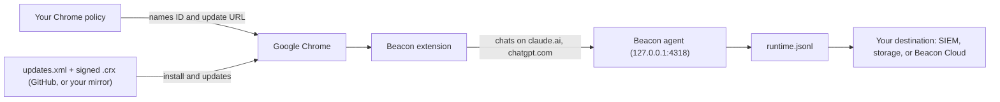

This guide takes a fleet from no browser extension to every managed Google Chrome installing it on its own, with the settings your team chooses locked in place. Follow the steps in order.

## What you'll set up

When you finish, Chrome on every machine in scope:

- Installs the signed Beacon browser extension without anyone clicking anything. Employees can't remove it or turn it off.
- Runs it with the settings you lock, such as capture on and full retention. The extension's popup shows them as managed by your organization.
- Captures chats on claude.ai and chatgpt.com and hands them to the Beacon agent on the same machine. Beacon sends them to the same destination as the rest of its telemetry: your own SIEM or storage, such as [Microsoft Sentinel](/log-forwarding/microsoft-sentinel), [Splunk](/log-forwarding/splunk), or an S3 bucket, or [Beacon Cloud](/log-forwarding/asymptote). The extension itself sends nothing anywhere else.
- Updates it by itself when a new version is released.



## Before you start

| You need | Why |
| --- | --- |
| Beacon installed and running on each machine, version 1.3.54 or later | The extension hands every chat to the local Beacon collector on `127.0.0.1:4318`. See the [macOS](/platforms/macos), [Windows](/platforms/windows), or [Linux](/platforms/linux) install. Earlier versions keep only the first 2 KB of each browser answer. |
| Beacon forwarding to your destination, if the chats should leave the machine | Browser chats follow the same path as the rest of Beacon's telemetry, to your SIEM or storage, or Beacon Cloud. See [Log forwarding](/log-forwarding). Without forwarding, they stay in the machine's runtime log. |
| Google Chrome 120 or later | |
| Machines your organization manages | Chrome installs an extension from outside the Chrome Web Store only on managed machines. On Windows that means joined to Active Directory or Microsoft Entra ID, or enrolled in Chrome Enterprise Core. On macOS it means enrolled in an MDM, or Chrome enrolled in Chrome Enterprise Core. Linux has no such requirement. |
| Access to the Chrome policy in your management tool | The Google Admin console, your MDM, or Group Policy. |
| HTTPS access from Chrome to `github.com` and `release-assets.githubusercontent.com` | Chrome downloads the update file and the extension from GitHub releases, which redirect to that host. If your network doesn't allow it, [host your own copy](#host-your-own-copy). |

## Values you'll need

| | |
| --- | --- |
| Extension ID | `omjgmakjpomopmmpdgmjbfojhbgdgijc` |
| Update URL | `https://github.com/Asymptote-Labs/agent-beacon/releases/download/ext-updates/updates.xml` |
| Signed package | `agent-beacon-browser-extension-<version>-chrome.crx` on each [`ext-v*` release](https://github.com/Asymptote-Labs/agent-beacon/releases) |

The ID never changes. It comes from the key the package is signed with, and Chrome checks that signature when it installs or updates the extension.

## 1. Force-install the extension

Point Chrome at the extension ID and the update URL. Chrome reads the update file, downloads the signed package, and installs it.

<Warning>
  `ExtensionSettings` is a single policy. If your fleet already sets it, for example to block every extension that isn't approved, add the Beacon entry to your existing value. Don't replace it. A `"*": {"installation_mode": "blocked"}` entry and a force-installed entry for this ID work together: the force-install wins for this ID.
</Warning>

<Tabs>
  <Tab title="Google Admin console">
    For Chrome browsers enrolled in Chrome Enterprise Core.

    1. In the [Admin console](https://admin.google.com), go to **Menu → Chrome browser → Apps & extensions → Users & browsers**.
    2. On the left, select the organizational unit to deploy to. Start with a test unit.
    3. Click **+** at the bottom right, then **Add Chrome app or extension by ID**.
    4. Enter the extension ID `omjgmakjpomopmmpdgmjbfojhbgdgijc`, choose **From a custom URL**, enter the update URL, and save.
    5. Click the extension in the list. In the panel on the right, set **Installation policy** to **Force install**, then click **Save**.
  </Tab>
  <Tab title="macOS (Jamf, Kandji, Intune)">
    Upload this configuration profile to your MDM as a custom profile and scope it to the Macs. In Jamf Pro, go to **Configuration Profiles → Upload**. In Kandji, add a **Custom Profile**. In Intune, create a macOS **Custom** configuration profile.

    ```xml title="beacon-chrome-extension.mobileconfig"
    <?xml version="1.0" encoding="UTF-8"?>
    <!DOCTYPE plist PUBLIC "-//Apple//DTD PLIST 1.0//EN" "http://www.apple.com/DTDs/PropertyList-1.0.dtd">
    <plist version="1.0">
    <dict>
      <key>PayloadContent</key>
      <array>
        <dict>
          <key>PayloadType</key>
          <string>com.google.Chrome</string>
          <key>PayloadIdentifier</key>
          <string>com.beacon.chrome-extension.install.chrome</string>
          <key>PayloadUUID</key>
          <string>3D7B530E-D890-4500-8778-7AA5B50EBA86</string>
          <key>PayloadVersion</key>
          <integer>1</integer>
          <key>PayloadDisplayName</key>
          <string>Google Chrome: Beacon extension</string>
          <key>ExtensionSettings</key>
          <dict>
            <key>omjgmakjpomopmmpdgmjbfojhbgdgijc</key>
            <dict>
              <key>installation_mode</key>
              <string>force_installed</string>
              <key>update_url</key>
              <string>https://github.com/Asymptote-Labs/agent-beacon/releases/download/ext-updates/updates.xml</string>
            </dict>
          </dict>
        </dict>
      </array>
      <key>PayloadDisplayName</key>
      <string>Beacon browser extension</string>
      <key>PayloadIdentifier</key>
      <string>com.beacon.chrome-extension.install</string>
      <key>PayloadType</key>
      <string>Configuration</string>
      <key>PayloadScope</key>
      <string>System</string>
      <key>PayloadUUID</key>
      <string>C08C5064-E5D5-45AB-9E18-95DED3AD3D3C</string>
      <key>PayloadVersion</key>
      <integer>1</integer>
    </dict>
    </plist>
    ```

    If your MDM already sends Chrome an `ExtensionSettings` value, add the `omjgmakjpomopmmpdgmjbfojhbgdgijc` entry to that profile instead of sending a second one.
  </Tab>
  <Tab title="Windows (Group Policy, Intune)">
    **Group Policy**, with the [Chrome ADMX templates](https://chromeenterprise.google/browser/download/) installed: open **Computer Configuration → Administrative Templates → Google → Google Chrome → Extensions → Extension management settings**, choose **Enabled**, and enter this value on one line:

    ```json
    {"omjgmakjpomopmmpdgmjbfojhbgdgijc":{"installation_mode":"force_installed","update_url":"https://github.com/Asymptote-Labs/agent-beacon/releases/download/ext-updates/updates.xml"}}
    ```

    **Intune**: in a **Settings catalog** profile, add **Google Chrome → Extensions → Extension management settings** and enter the same value.

    **Registry**, for a script or another tool:

    ```text title="beacon-chrome-extension.reg"
    Windows Registry Editor Version 5.00

    [HKEY_LOCAL_MACHINE\SOFTWARE\Policies\Google\Chrome]
    "ExtensionSettings"="{\"omjgmakjpomopmmpdgmjbfojhbgdgijc\":{\"installation_mode\":\"force_installed\",\"update_url\":\"https://github.com/Asymptote-Labs/agent-beacon/releases/download/ext-updates/updates.xml\"}}"
    ```
  </Tab>
  <Tab title="Linux">
    Write this file as root. Chrome reads every JSON file in the directory.

    ```json title="/etc/opt/chrome/policies/managed/beacon-extension.json"
    {
      "ExtensionSettings": {
        "omjgmakjpomopmmpdgmjbfojhbgdgijc": {
          "installation_mode": "force_installed",
          "update_url": "https://github.com/Asymptote-Labs/agent-beacon/releases/download/ext-updates/updates.xml"
        }
      }
    }
    ```
  </Tab>
</Tabs>

If your fleet sets `ExtensionAllowedTypes`, it must include `extension`, or Chrome refuses the install.

## 2. Lock the extension's settings

Choose the settings employees should not change. Any setting you push is shown as managed in the extension's popup and options page, and the extension refuses changes to it. Settings you leave out keep their defaults and stay editable.

| Setting | Type | Values | Default |
| --- | --- | --- | --- |
| `enabled` | boolean | Capture on (`true`) or off (`false`) | `true` |
| `retention` | string | `full` keeps prompt and answer text, `redacted` keeps it with email addresses and token-like strings masked, `metadata` keeps no text, only counts, models, and IDs | `full` |
| `endpoint` | string | The Beacon collector's OTLP logs URL. Only `127.0.0.1`, `localhost`, or `[::1]` are accepted | `http://127.0.0.1:4318/v1/logs` |
| `sites` | object | `claude_web` and `chatgpt_web`, each `true` or `false` | both `true` |

The examples lock capture on with full retention.

<Tabs>
  <Tab title="Google Admin console">
    Click the extension in **Apps & extensions → Users & browsers**. In **Policy for extensions**, enter the settings with each value wrapped in `{"Value": ...}`, then click **Save**:

    ```json
    {"enabled": {"Value": true}, "retention": {"Value": "full"}}
    ```
  </Tab>
  <Tab title="macOS (Jamf, Kandji, Intune)">
    Upload a second custom profile. Its payload type is the extension's own preference domain, `com.google.Chrome.extensions.omjgmakjpomopmmpdgmjbfojhbgdgijc`.

    ```xml title="beacon-chrome-extension-settings.mobileconfig"
    <?xml version="1.0" encoding="UTF-8"?>
    <!DOCTYPE plist PUBLIC "-//Apple//DTD PLIST 1.0//EN" "http://www.apple.com/DTDs/PropertyList-1.0.dtd">
    <plist version="1.0">
    <dict>
      <key>PayloadContent</key>
      <array>
        <dict>
          <key>PayloadType</key>
          <string>com.google.Chrome.extensions.omjgmakjpomopmmpdgmjbfojhbgdgijc</string>
          <key>PayloadIdentifier</key>
          <string>com.beacon.chrome-extension.settings.extension</string>
          <key>PayloadUUID</key>
          <string>8A970138-8A48-4DE5-A062-7F66188BB924</string>
          <key>PayloadVersion</key>
          <integer>1</integer>
          <key>PayloadDisplayName</key>
          <string>Beacon extension settings</string>
          <key>enabled</key>
          <true/>
          <key>retention</key>
          <string>full</string>
        </dict>
      </array>
      <key>PayloadDisplayName</key>
      <string>Beacon browser extension settings</string>
      <key>PayloadIdentifier</key>
      <string>com.beacon.chrome-extension.settings</string>
      <key>PayloadType</key>
      <string>Configuration</string>
      <key>PayloadScope</key>
      <string>System</string>
      <key>PayloadUUID</key>
      <string>56C05D7A-AD1B-4DE0-AA1C-B901891ECDCE</string>
      <key>PayloadVersion</key>
      <integer>1</integer>
    </dict>
    </plist>
    ```

    For per-site switches, add a `sites` dictionary with `claude_web` and `chatgpt_web` booleans.
  </Tab>
  <Tab title="Windows (Group Policy, Intune)">
    Chrome reads an extension's settings from its own registry key. Push these values with Group Policy Preferences, an Intune script, or another tool:

    ```text title="beacon-chrome-extension-settings.reg"
    Windows Registry Editor Version 5.00

    [HKEY_LOCAL_MACHINE\SOFTWARE\Policies\Google\Chrome\3rdparty\extensions\omjgmakjpomopmmpdgmjbfojhbgdgijc\policy]
    "enabled"=dword:00000001
    "retention"="full"
    ```

    Booleans are `DWORD` values (`1` or `0`) and strings are `REG_SZ`. For per-site switches, add a `sites` subkey under `policy` with `claude_web` and `chatgpt_web` `DWORD` values.
  </Tab>
  <Tab title="Linux">
    Add the settings to a policy file under the `3rdparty` key:

    ```json title="/etc/opt/chrome/policies/managed/beacon-extension-settings.json"
    {
      "3rdparty": {
        "extensions": {
          "omjgmakjpomopmmpdgmjbfojhbgdgijc": {
            "enabled": true,
            "retention": "full"
          }
        }
      }
    }
    ```
  </Tab>
</Tabs>

<Note>
  With `full` retention, the complete text of every prompt and answer on claude.ai and chatgpt.com is written to the machine's runtime log, and goes wherever Beacon forwards that log: your SIEM or storage, or Beacon Cloud. Make sure that matches the notice your organization gives employees.
</Note>

## 3. Try it on one machine

Apply the policies to one test machine first.

1. On that machine, open `chrome://policy` and click **Reload policies**. `ExtensionSettings` and the extension's policy should show **OK**. If an entry is marked `[BLOCKED]`, the machine doesn't count as managed; see [Troubleshooting](#troubleshooting).
2. Within a minute or two, `chrome://extensions` lists **Agent Beacon — Browser Collector** as installed by your administrator, with no remove button.
3. Click the extension's icon (or find it in Chrome's puzzle-piece menu). The popup says **Some settings are managed by your organization**, and the settings you locked are greyed out with your values.
4. Send a short message on claude.ai or chatgpt.com, then check that Beacon recorded it:

   <CodeGroup>
   ```bash macOS and Linux
   sudo grep -E 'claude_web|chatgpt_web' /var/log/beacon-agent/runtime.jsonl | tail -n 5
   ```

   ```powershell Windows
   Select-String -Path "$env:ProgramData\Beacon\Endpoint\logs\runtime.jsonl" -Pattern 'claude_web|chatgpt_web' | Select-Object -Last 5
   ```
   </CodeGroup>

   Each line is one event. Its `beacon.content.retention` attribute shows the retention you set. Beacon then forwards these events like the rest of its telemetry, so within a few minutes they also appear in your destination, such as your Microsoft Sentinel workspace or Beacon Cloud. Search for the harness names `claude_web` and `chatgpt_web`.

## 4. Roll out

1. Remove any copy of the extension someone loaded by hand through developer mode (**Load unpacked**). Chrome gives that copy a different ID, so it would run alongside the managed one and either copy could capture a chat. A `"*": {"installation_mode": "blocked"}` entry in `ExtensionSettings` also stops Chrome from loading unpacked extensions.
2. Widen the policies from the test machine to the rest of the fleet.
3. Spot-check a few machines with step 3.

## Updates

Nothing to do. Chrome checks the update URL about every five hours and when it starts. When a new version is released, every machine installs it on its own, keeping the settings you locked. `chrome://extensions` shows the installed version, and the [releases page](https://github.com/Asymptote-Labs/agent-beacon/releases) lists the changes in each `ext-v*` release.

## Host your own copy

If Chrome can't reach GitHub, or you want to approve each version before it reaches the fleet, serve the update file and the package from your own HTTPS server. The signature stays valid, so the extension ID doesn't change.

1. Download the signed package and its checksum from the [`ext-v*` release](https://github.com/Asymptote-Labs/agent-beacon/releases) you want, and check it:

   ```bash
   VERSION=0.2.0
   BASE="https://github.com/Asymptote-Labs/agent-beacon/releases/download/ext-v${VERSION}"
   curl -fsSLO "${BASE}/agent-beacon-browser-extension-${VERSION}-chrome.crx"
   curl -fsSLO "${BASE}/agent-beacon-browser-extension-${VERSION}-chrome.crx.sha256"
   shasum -a 256 -c "agent-beacon-browser-extension-${VERSION}-chrome.crx.sha256"
   ```

2. Copy the `.crx` to your server, and publish an `updates.xml` next to it that names its URL, version, and SHA-256 (the first field of the `.sha256` file):

   ```xml title="updates.xml"
   <?xml version='1.0' encoding='UTF-8'?>
   <gupdate xmlns='http://www.google.com/update2/response' protocol='2.0'>
     <app appid='omjgmakjpomopmmpdgmjbfojhbgdgijc'>
       <updatecheck codebase='https://intranet.example.com/beacon/agent-beacon-browser-extension-0.2.0-chrome.crx' version='0.2.0' hash_sha256='<sha256 of the .crx>' />
     </app>
   </gupdate>
   ```

3. In step 1's policy, use your `updates.xml` URL as `update_url`, and add `"override_update_url": true`. Without it, installed copies keep checking GitHub, because the extension itself names that URL.

   ```json
   {"omjgmakjpomopmmpdgmjbfojhbgdgijc": {"installation_mode": "force_installed", "update_url": "https://intranet.example.com/beacon/updates.xml", "override_update_url": true}}
   ```

4. For each new release, repeat steps 1 and 2. Machines stay on the version your `updates.xml` names until you change it.

## Troubleshooting

<AccordionGroup>
  <Accordion title="chrome://policy marks the entry [BLOCKED]">
    Chrome doesn't consider the machine managed, so it refuses to install an extension from outside the Chrome Web Store. Join the machine to Active Directory or Entra ID, enroll it in your MDM, or enroll Chrome in Chrome Enterprise Core.
  </Accordion>
  <Accordion title="The policy shows OK but the extension never appears">
    - If you set `ExtensionAllowedTypes`, add `extension` to it.
    - Check that the machine can reach `github.com` and `release-assets.githubusercontent.com` over HTTPS, or [host your own copy](#host-your-own-copy).
    - Reload policies in `chrome://policy`, or restart Chrome.
  </Accordion>
  <Accordion title="Settings aren't locked">
    Chrome drops a value that doesn't match the extension's settings schema, such as a misspelled retention value or a string where a boolean belongs. In the Google Admin console, each value must be wrapped as `{"Value": ...}`. Open `chrome://policy`, check **Show policies with no value set**, and look for errors under the extension's ID.
  </Accordion>
  <Accordion title="The popup says your organization's settings could not be read">
    Chrome couldn't read the extension's managed settings. Until it can, the extension captures nothing and refuses changes, because it can't know which settings are locked. Restart Chrome. If it persists, check `chrome://policy` for errors.
  </Accordion>
  <Accordion title="No events reach the runtime log">
    Check that Beacon is running on the machine: `sudo /opt/beacon/bin/beacon endpoint status --system` on macOS. The popup shows the endpoint the extension sends to and how many events are waiting to be delivered.
  </Accordion>
  <Accordion title="Chats are in the runtime log but not in your SIEM">
    Browser chats reach your destination only through Beacon's forwarding, the same path as the rest of its telemetry. Check that forwarding to that destination is set up and running; see [Log forwarding](/log-forwarding).

    In Microsoft Sentinel, browser chats land in `BeaconRuntime_CL` with `HarnessName` `claude_web` or `chatgpt_web`. The prompt and answer text are inside `RawData`, so a custom data collection rule transform that drops `RawData` loses them. To see them:

    ```kusto
    BeaconRuntime_CL
    | where HarnessName in ("claude_web", "chatgpt_web")
    | extend Event = todynamic(tostring(RawData))
    | project TimeGenerated, HarnessName, EventAction,
        Retention = tostring(Event.raw.attributes["beacon.content.retention"]),
        Prompt = tostring(Event.prompt.text), Answer = tostring(Event.gen_ai.output.messages)
    ```
  </Accordion>
  <Accordion title="Two copies of the extension are installed">
    One is a copy loaded by hand in developer mode. Remove it from `chrome://extensions`. See [Roll out](#4-roll-out).
  </Accordion>
  <Accordion title="DevTools won't open on the extension">
    Chrome turns off DevTools for extensions installed by policy unless the `DeveloperToolsAvailability` policy is `1`. Change it only on machines where you need to debug the extension.
  </Accordion>
</AccordionGroup>

## Reference

If your management tool only offers the older `ExtensionInstallForcelist` policy, add this entry to its list. It installs the extension the same way, but can't set `override_update_url` for a mirror.

```text
omjgmakjpomopmmpdgmjbfojhbgdgijc;https://github.com/Asymptote-Labs/agent-beacon/releases/download/ext-updates/updates.xml
```

## Related

<Columns cols={2}>
  <Card title="Browser extension" icon="puzzle-piece" href="/runtimes/browser-extension">
    What the extension captures, its settings, and retained content.
  </Card>
  <Card title="Chromium browsers" icon="globe" href="/runtimes/browser-extension-chromium">
    Edge, Brave, and other Chromium browsers.
  </Card>
</Columns>
