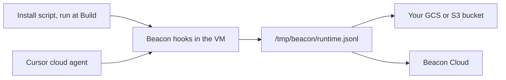

## Overview

Use this integration to capture what Cursor cloud agents do and send each
session log to a Google Cloud Storage or Amazon S3 bucket you own, or to
[Beacon Cloud](/deployment/managed). Nothing is committed to your repository,
and nothing changes for developers who use Cursor on their own machines.

This flow depends on the Beacon CLI. You run `beacon cloud` commands from your
workstation to create a bucket upload path and to generate the install script
that sets up Beacon inside each Cursor cloud environment.

## How it works

Cursor cloud agents run in VMs that Cursor manages, so Beacon cannot use the
long-running endpoint agent that local installs use. Beacon runs inside the VM
instead:

1. Each Cursor environment has an install script. Cursor runs it when it
   creates a Build, the prepared VM that every agent in the environment starts
   from.
2. Beacon's install script, from `beacon cloud cursor print-setup`, downloads
   `beacon-hooks` to `/tmp/beacon/bin` and writes Beacon's hooks to
   `.cursor/hooks.json` in the checkout. It lists that file in
   `.git/info/exclude`, so agents never see it as a change to commit.
3. The Build keeps both, so every agent starts with Beacon's hooks in place.
   During a session the hooks write `/tmp/beacon/runtime.jsonl` and upload it
   as they run: to a bucket as one object per agent, rewritten as the session
   grows, or to Beacon Cloud as new lines.



The setup has four parts:

1. Create a GCS or S3 upload path with Beacon, or get a device key for Beacon Cloud.
2. Add Beacon's upload settings to Cursor as secrets.
3. Create a Cursor environment with Beacon's install script and let its first Build finish.
4. Run a cloud agent and check the session log.

With a bucket, each Cursor cloud agent writes one readable JSONL object:

```text
gs://<bucket>/<prefix>/runtime/date=YYYY-MM-DD/<timestamp>-cursor_cloud-<cursor_conversation_id>.jsonl.gz
```

or:

```text
s3://<bucket>/<prefix>/runtime/date=YYYY-MM-DD/<timestamp>-cursor_cloud-<cursor_conversation_id>.jsonl.gz
```

The object is named after the conversation that uploaded first, normally the
agent's. Beacon uses Cursor's `conversation_id` hook field as the default
`run_id` for Cursor cloud telemetry. If you set `BEACON_RUN_ID` yourself, Beacon
preserves that value instead.

### Cloud agents started from Cursor desktop

A cloud agent runs in Cursor's VM whether you start it from the web, Slack, the
API, or the Cursor desktop app with **Cloud** selected. Only this setup records
what it does.

If your machine also runs a local Beacon endpoint, the desktop app runs the
hooks installed there for a cloud agent it shows, but only for the agent's
reasoning and subagent events. Beacon does not record those calls on the
endpoint, so a cloud agent does not show up as a partial local session. Beacon
`v1.3.60` and earlier recorded them as `agent.reasoning` and `subagent.stopped`
events from your machine, under session ids that start with `bc-` (the cloud
agent) or `task-call-` (one of its subagents). Exclude those session ids when
you read older endpoint data.

## Prerequisites

- The latest Beacon CLI on your workstation.
- For GCS: `gcloud` installed and authenticated to a project where you can
  create buckets, service accounts, IAM bindings, and service account keys.
- For S3: AWS CLI installed and authenticated to an account where you can
  create buckets, IAM users, inline policies, and access keys.
- `jq` on the verification workstation.
- Cursor cloud agent access for the repository, and permission to create a
  cloud agent environment for it.
- A Cursor cloud environment with outbound access to:
  - For Beacon Cloud: the ingest host from your device key hand-off
  - For GCS: `oauth2.googleapis.com` and `storage.googleapis.com`
  - For S3: `s3.<region>.amazonaws.com`
  - `github.com` and `*.githubusercontent.com`, where the install script
    downloads Beacon

Install or upgrade Beacon before you start:

```bash
brew update
brew trust asymptote-labs/tap
brew tap asymptote-labs/tap
brew install beacon
brew upgrade beacon
beacon version
```

For GCS, authenticate `gcloud` and select your project:

```bash
gcloud auth login
gcloud config set project <your-gcp-project>
```

## 1. Choose where session logs go

Send session logs to a bucket you own (GCS or S3) or to Beacon Cloud.

### Beacon Cloud

To send Cursor cloud sessions to [Beacon Cloud](/deployment/managed), where they
appear next to your endpoints' sessions, [contact us](https://asymptotelabs.ai/contact)
for a device key. A cloud VM has no browser, so it cannot run
[`beacon endpoint connect`](/cli/endpoint-connect). The key is minted for the
environment and bound to your organization, and it is listed under **Devices**
on the dashboard like any laptop and revocable from there. You receive three
values for step 2: `BEACON_CLOUD_UPLOAD=asymptote`, the ingest URL, and the key.

### GCS

From your workstation, choose a bucket and prefix:

```bash
export GCP_PROJECT="your-gcp-project"
export BEACON_TEST_BUCKET="your-beacon-cloud-agent-traces"
export BEACON_CLOUD_GCS_PREFIX="agent-traces/customer=my-team"
```

Review the GCP changes Beacon will make:

```bash
beacon cloud gcs setup \
  --project "$GCP_PROJECT" \
  --bucket "$BEACON_TEST_BUCKET" \
  --location us-central1 \
  --prefix "$BEACON_CLOUD_GCS_PREFIX" \
  --service-account beacon-cloud-trace-uploader \
  --print
```

<Frame caption="Review the bucket, service account, and IAM commands before applying them.">
  
</Frame>

Apply the setup and print the cloud telemetry environment variables:

```bash
beacon cloud gcs setup \
  --project "$GCP_PROJECT" \
  --bucket "$BEACON_TEST_BUCKET" \
  --location us-central1 \
  --prefix "$BEACON_CLOUD_GCS_PREFIX" \
  --service-account beacon-cloud-trace-uploader \
  --apply \
  --print-env
```

Copy the printed values. Redact `BEACON_CLOUD_GCS_CREDENTIALS_B64` anywhere you
share screenshots or logs.

<Frame caption="Copy the printed BEACON_CLOUD_GCS_* variables into the Cursor cloud environment.">
  
</Frame>

The helper creates a dedicated uploader service account and grants it
`roles/storage.objectUser` on the selected bucket, which can read, list,
overwrite, and delete objects in that bucket, not only upload them.

### S3

From your workstation, choose a bucket, region, and prefix:

```bash
export AWS_REGION="us-east-1"
export BEACON_TEST_BUCKET="your-beacon-cloud-agent-traces"
export BEACON_CLOUD_S3_PREFIX="agent-traces/customer=my-team"
```

Review the AWS changes Beacon will make:

```bash
beacon cloud s3 setup \
  --bucket "$BEACON_TEST_BUCKET" \
  --region "$AWS_REGION" \
  --prefix "$BEACON_CLOUD_S3_PREFIX" \
  --iam-user beacon-cloud-trace-uploader \
  --print
```

Apply the setup and print the cloud telemetry environment variables:

```bash
beacon cloud s3 setup \
  --bucket "$BEACON_TEST_BUCKET" \
  --region "$AWS_REGION" \
  --prefix "$BEACON_CLOUD_S3_PREFIX" \
  --iam-user beacon-cloud-trace-uploader \
  --apply \
  --print-env
```

The helper creates a dedicated IAM user and grants it `s3:PutObject` only under
the selected bucket prefix.

Copy the printed values. Treat `AWS_ACCESS_KEY_ID` and
`AWS_SECRET_ACCESS_KEY` as sensitive and redact them from screenshots and logs.

## 2. Add the upload settings to Cursor

In [cursor.com/dashboard/cloud-agents](https://cursor.com/dashboard/cloud-agents),
open **Secrets** and add the values for your destination. User secrets reach
every cloud agent you start, and team secrets reach your team's. Cursor gives
secrets only to agents started after you add them.

For Beacon Cloud, add:

```bash
BEACON_CLOUD_UPLOAD=asymptote
BEACON_CLOUD_INGEST_URL=<ingest-url-from-your-hand-off>
BEACON_CLOUD_DEVICE_KEY=<device-key-from-your-hand-off>
```

For GCS, add:

```bash
BEACON_CLOUD_GCS_BUCKET=<bucket-from-setup>
BEACON_CLOUD_GCS_PREFIX=<prefix-from-setup>
BEACON_CLOUD_GCS_CREDENTIALS_B64=<base64-service-account-json>
```

For S3, add:

```bash
BEACON_CLOUD_UPLOAD=s3
BEACON_CLOUD_S3_BUCKET=<bucket-from-setup>
BEACON_CLOUD_S3_PREFIX=<prefix-from-setup>
BEACON_CLOUD_S3_REGION=<region-from-setup>
AWS_ACCESS_KEY_ID=<access-key-id-from-setup>
AWS_SECRET_ACCESS_KEY=<secret-access-key-from-setup>
```

Optionally, set `BEACON_CLOUD_USER_ID_HASH` to a stable id for the person or
test; Beacon records it as `user.uid`. Beacon's hooks set `BEACON_ORIGIN=cloud`,
`BEACON_RUN_PROVIDER=cursor_cloud`, and `BEACON_RUN_EPHEMERAL=true` themselves.

If your Cursor environment restricts outbound network access, allow the hosts
listed under [Prerequisites](#prerequisites).

## 3. Create the Cursor environment

Generate the install script for the latest Beacon release:

```bash
beacon cloud cursor print-setup --version vX.Y.Z
```

Replace `vX.Y.Z` with the latest Beacon release tag. The script:

- downloads `beacon-hooks` to `/tmp/beacon/bin`,
- writes Beacon's hooks to `.cursor/hooks.json` in the checkout and lists that
  file in `.git/info/exclude`,
- leaves the repository's own `.cursor/hooks.json` alone if it commits one.

Then create the environment:

1. In [cursor.com/dashboard/cloud-agents](https://cursor.com/dashboard/cloud-agents),
   open **Environments** and create one for your repository.
2. Paste the script into **Install script**.
3. Wait for the first Build to finish on the environment's **Builds** tab. A
   successful Build's log ends with `Beacon wrote <repository>/.cursor/hooks.json`.

<Warning>
  An agent started before the environment's first Build runs on Cursor's
  default image, where the install script has not run, so Beacon records nothing
  for it. Start agents once the first Build has finished.
</Warning>

If your repository commits a `.cursor/environment.json`, Cursor takes the
install script from that file and the dashboard field is read-only. Save the
script in the repository, for example as `.cursor/beacon-install.sh`, and run it
from the file's `install` command. The hooks are still written at Build time and
stay out of the repository.

`--safe-hooks` leaves out the shell and edit hooks (`beforeShellExecution`,
`afterShellExecution`, `afterFileEdit`), so you can prove the upload works before
the agent's commands and edits pass through Beacon.

## 4. Run a cloud agent task

Start a cloud agent in the environment with a task that uses tools. For example:

```text
Read the README, run pwd && ls, create a tiny temporary markdown note under
/tmp, then summarize what you did.
```

Then send a prompt-only follow-up with a unique marker:

```text
BEACON_PROMPT_SMOKE_<unique-id>

Do not inspect files or run tools. Reply exactly: PROMPT CAPTURE TEST COMPLETE
```

<Note>
  Cursor runs fewer hooks in an agent's first turn, so the launch prompt is not
  recorded. The follow-up prompt is. See [What Beacon records](#what-beacon-records).
</Note>

## 5. Verify the session log

For Beacon Cloud, open the dashboard's sessions view. The session appears under
the environment's device a minute or two after the agent's turn ends.

For GCS, list the uploaded session objects:

```bash
gcloud storage ls --recursive "gs://${BEACON_TEST_BUCKET}/${BEACON_CLOUD_GCS_PREFIX}/"
```

For S3:

```bash
aws s3 ls --recursive "s3://${BEACON_TEST_BUCKET}/${BEACON_CLOUD_S3_PREFIX}/"
```

You should see a path like:

```text
runtime/date=YYYY-MM-DD/<timestamp>-cursor_cloud-<run_id>.jsonl.gz
```

<Frame caption="Beacon uploads one readable runtime.jsonl object per Cursor cloud agent session.">
  
</Frame>

Inspect the log:

```bash
gcloud storage cat "gs://${BEACON_TEST_BUCKET}/${BEACON_CLOUD_GCS_PREFIX}/runtime/date=<date>/<object>.jsonl.gz" | gzip -dc | head
```

For S3:

```bash
aws s3 cp "s3://${BEACON_TEST_BUCKET}/${BEACON_CLOUD_S3_PREFIX}/runtime/date=<date>/<object>.jsonl.gz" - | gzip -dc | head
```

For GCS, verify prompt capture with the unique marker from the follow-up:

```bash
gcloud storage cat "gs://${BEACON_TEST_BUCKET}/${BEACON_CLOUD_GCS_PREFIX}/runtime/date=<date>/<object>.jsonl.gz" \
  | gzip -dc \
  | jq -c 'select(.event.action == "prompt.submitted") | {prompt: .prompt.text, run: .run}'
```

For S3:

```bash
aws s3 cp "s3://${BEACON_TEST_BUCKET}/${BEACON_CLOUD_S3_PREFIX}/runtime/date=<date>/<object>.jsonl.gz" - \
  | gzip -dc \
  | jq -c 'select(.event.action == "prompt.submitted") | {prompt: .prompt.text, run: .run}'
```

The last prompt can be the final record in the object. That proves Beacon
uploaded the prompt immediately rather than waiting for a later tool event.

Expected fields include:

```text
vendor=beacon
product=endpoint-agent
schema_version=1.0
origin=cloud
harness.name=cursor
run.provider=cursor_cloud
```

## What Beacon records

From an agent's second turn on, Beacon records prompts, the agent's reasoning
and replies, shell commands with their output and exit codes, file reads and
edits, tool and MCP calls, subagent start and stop, compaction, and the end of
each turn with its status (`completed`, `aborted`, or `error`).

Cursor runs fewer hooks in cloud agents than in its desktop app, which leaves
these gaps:

- **First turn.** During an agent's first turn Cursor runs only the tool,
  shell, file, and turn-end hooks. That turn's prompt, reasoning, and reply, and
  the start and stop of any subagent it launches, are not recorded.
- **Subagents.** A subagent's own events carry its own conversation id, so they
  appear as a separate session. The agent's session records the subagent's start
  and stop (from the second turn on), but nothing in Cursor's cloud hook
  payloads ties the subagent's events back to the agent that started it.
- **Web search.** Searches the agent runs did not fire any hook in our tests,
  so they are not recorded.
- **Session start and end.** Cursor does not run `sessionStart` or `sessionEnd`
  in cloud agents. See [Cursor's Cloud Agent hook support matrix](https://cursor.com/docs/hooks#cloud-agent-support).

## Committing the hooks instead

To keep Beacon's hooks in the repository, generate them, commit them, and keep
the install script for the binary. The script sees the committed file and
leaves it alone:

```bash
mkdir -p .cursor
beacon cloud cursor print-hooks \
  --binary-path /tmp/beacon/bin/beacon-hooks \
  --log-path /tmp/beacon/runtime.jsonl > .cursor/hooks.json
git add .cursor/hooks.json
git commit -m "Add Beacon Cursor Cloud hooks"
git push
```

Cursor also runs a repository's project hooks in local sessions, so everyone
who opens the repository in Cursor runs committed hooks too, and those hooks run
`/tmp/beacon/bin/beacon-hooks` from a world-writable directory. On a machine
where another user or process can create that file, it runs with the
developer's permissions on every hook. Keep the hooks uncommitted, with the
install script, unless every machine that opens the repository is trusted. The
same applies to Beacon entries added to a `.cursor/hooks.json` the repository
already commits.

## Security note

The self-serve flows create a dedicated GCS service account with
`roles/storage.objectUser` on one bucket (read, list, overwrite, and delete) or
an AWS IAM user scoped to object uploads, then store its credentials in the
Cursor cloud environment. This is useful for proof-of-concept testing, but treat those
environment variables as sensitive credentials.

Store credential values as Cursor Runtime Secrets, avoid broad credentials,
rotate test keys after use, and review access before using this flow with
sensitive telemetry.

## Troubleshooting

### Nothing arrives

Confirm the environment has a successful Build and that the agent started after
it. Then ask the agent to run:

```bash
ls -la /tmp/beacon/bin .cursor
grep -v '^#' .git/info/exclude
```

`/tmp/beacon/bin/beacon-hooks` and `.cursor/hooks.json` should both exist, and
the exclude list should name `.cursor/hooks.json`. If they don't, the agent ran
without Beacon's install script: check the Build's log.

Confirm hooks wrote telemetry:

```bash
ls -l /tmp/beacon/runtime.jsonl
head /tmp/beacon/runtime.jsonl
```

If `runtime.jsonl` exists but nothing arrives, check network access and
credentials. The cloud VM must reach the Beacon Cloud ingest host, the GCS
OAuth and storage endpoints, or the regional S3 endpoint, depending on where
you send logs.

If `runtime.jsonl` does not exist, confirm the task used a Cursor Cloud
supported hook surface such as prompt submission, a file read, shell command,
file edit, tool use, subagent event, or compaction event. Cursor documents the
supported and unsupported cloud hooks in
its [Cloud Agent hook support matrix](https://cursor.com/docs/hooks#cloud-agent-support).

### Cursor tries to commit hook settings

Beacon's install script lists `.cursor/hooks.json` in `.git/info/exclude`. If an
agent shows `.cursor/hooks.json` as a change, the environment's install script
predates that: regenerate it with `beacon cloud cursor print-setup` and paste it
into the environment again.

```bash
git status --short -- .cursor
```

## Related

<Columns cols={2}>
  <Card title="Cursor runtime support" icon="terminal" href="/runtimes/cursor">
    Review local Cursor telemetry through Beacon-managed hooks.
  </Card>
  <Card title="Log forwarding" icon="database" href="/log-forwarding">
    Compare direct cloud-agent uploads with local endpoint object-storage forwarding.
  </Card>
  <Card title="Beacon Cloud" icon="cloud" href="/deployment/managed">
    Use managed secure ingest for production enterprise cloud-agent telemetry.
  </Card>
  <Card title="Agent Beacon on GitHub" icon="github" href="https://github.com/asymptote-labs/agent-beacon">
    Request new cloud-agent destinations or contribute support.
  </Card>
</Columns>
