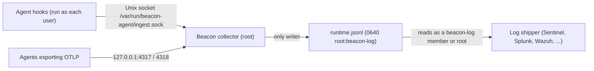

A system-mode endpoint keeps one runtime log for every user on the machine, `/var/log/beacon-agent/runtime.jsonl`. Your SIEM shipper reads that file. Restricted log access is the mode to use when no ordinary account on the machine should be able to change that file or read it.

## Why the default log is shared

Agent hooks run as the person using the agent, not as root. In the default **shared** mode they append to the system log directly, so the file has to be writable by every account (`0666`). That has two consequences on a machine with more than one account, or one where a user should not be trusted with the evidence:

- Any local account can truncate, rewrite or delete events already in the log, including before your shipper has read them.
- Any local account can read every other user's prompts, command output and diffs.

## What restricted mode changes

In the **restricted** mode the root collector is the only process that writes the log. Hooks hand their events to it over a local Unix socket instead of opening the file.



| | Shared (default) | Restricted |
|---|---|---|
| Who writes `runtime.jsonl` | The collector and every user's hooks | The collector only |
| How hooks deliver events | Append to the file | Send to `/var/run/beacon-agent/ingest.sock` |
| Log and archives | `0666` | `0640`, owner `root`, group `beacon-log` |
| Log directory | Readable by everyone | `2750`, owner `root`, group `beacon-log` |
| Who can read the log | Every account | Root and members of `beacon-log` |
| Who can modify the log | Every account | Root only |
| User recorded on hook events | What the hook reports | The account the operating system says sent the event (`user.uid`, `user.name`) |
| Collector down or restarting | Hooks keep appending | Hooks hold events in a private spool and send them later |

The event format and every field stay the same, so a parser, DCR transform or SIEM rule built for the shared log needs no change. Nothing leaves the machine: the socket is a local file, and hooks still never touch the network.

### Delivery while the collector is down

If the collector is stopped or restarting, a hook writes its events to a spool in that user's home, `~/.beacon/endpoint/spool` (`0700` directory, `0600` files), and returns at once, so the agent is never held up. The next event that user's hooks send delivers the spooled ones first. Each spool is capped at 8 MiB; events past that are dropped and counted rather than filling the disk. [`beacon endpoint doctor`](/cli/endpoint-doctor#runtime_log_access) reports a collector that is not answering on the socket and any events waiting in the caller's spool.

## Turn it on

<Note>
  Restricted log access applies to system-mode installs on macOS and Linux. It is not available on Windows yet, and a per-user log in `~/.beacon` is already private to its owner.
</Note>

On a new system install:

```bash title="Install with restricted log access"
sudo beacon endpoint install --system --log-access restricted
```

On an endpoint that is already installed, including one installed from the signed package, switch it in place. This is also the command to put in an MDM script policy (Jamf, Fleet) that runs after the package:

```bash title="Switch an existing endpoint to restricted"
sudo beacon endpoint repair --system --log-access restricted
```

For package installs you can instead set `BEACON_LOG_ACCESS=restricted` in the environment of the package's install script.

Switching replaces the log and its archives with fresh copies, so a file handle another account opened while the log was shared stops reaching it. Existing events are kept.

The mode is recorded in `config.json` as `log_access` and in a root-owned `.beacon-log-access` marker beside the log. `beacon endpoint repair`, package upgrades, the Jamf `repair-hooks.sh` policy, and a reinstall after `uninstall --keep-logs` all keep it, so you set it once per endpoint.

## Let your log shipper read the log

Install creates the `beacon-log` group if it is missing and adds nobody to it. A shipper that runs as root keeps working with no change, and so does the Beacon Cloud forwarder. A shipper that runs as its own account needs to join the group, and then be restarted so it picks up the new membership:

```bash title="Add a shipper's account to beacon-log"
# Linux
sudo usermod -aG beacon-log <account>
# macOS
sudo dseditgroup -o edit -a <account> -t user beacon-log
```

If you are not sure which account a shipper runs as, look at its process:

```bash title="Find the account a shipper runs as"
ps -eo user,comm | grep -i -E '<shipper process name>'
```

Then confirm that account can read the log:

```bash title="Check the shipper can read the log"
sudo -u <account> test -r /var/log/beacon-agent/runtime.jsonl && echo readable
```

### Microsoft Sentinel

**Azure Monitor Agent.** AMA tails the file as the account its agent runs under. If that is not root, add it to `beacon-log` as above and restart AMA. The DCR, transform and `BeaconRuntime_CL` table are unchanged.

**Vector and the Logs Ingestion API.** The [`beacon-sentinel` service](/log-forwarding/microsoft-sentinel#vector-and-the-logs-ingestion-api) runs Vector as a `DynamicUser`, which has no fixed account to add to a group. Give the unit the group instead:

```ini title="/etc/systemd/system/beacon-sentinel.service"
[Service]
DynamicUser=yes
SupplementaryGroups=beacon-log
```

```bash title="Apply it"
sudo systemctl daemon-reload
sudo systemctl restart beacon-sentinel
```

Vector keeps its read position in `/var/lib/vector/beacon-sentinel`, so it resumes where it stopped and does not resend the log.

### Other shippers

The same rule applies to Splunk Universal Forwarder, Filebeat or Elastic Agent, the Datadog Agent, Wazuh, Rapid7, Sumo Logic and any customer-managed shipper reading the [local JSONL log](/log-forwarding/local-jsonl): running as root, nothing changes; running as its own account, add that account to `beacon-log` and restart it. Splunk HEC and Falcon LogScale HEC are sent by the collector itself and are not affected.

## Who can do what on a restricted endpoint

| Action | Who can do it |
|---|---|
| Install, repair, uninstall, connect or disconnect the system endpoint, or change its log access mode | Root only. These commands change root-owned files and services, and refuse or fail without `sudo` |
| Append events to the log | Only the collector. Users' hooks deliver through the socket, stamped with the sending account |
| Rewrite, truncate or delete events already in the log | Root only |
| Read the log, including with `beacon endpoint dashboard`, `beacon scan`, `beacon traces`, and the session lookups in `beacon share`, `beacon handoff` and `beacon git` | Root and members of `beacon-log` |
| See whether the endpoint is restricted | Anyone, with `beacon endpoint status --system`. Without `sudo`, status says it cannot read the log rather than reporting it empty |

Add people to `beacon-log` only when they should see every user's sessions on that machine, the same as you would for a shipper.

## What restricted mode does and does not protect

Restricted mode protects the **log**: what has been recorded cannot be altered or read by other local accounts. It does not take control of each person's agent away from them.

- **A user still controls their own agent.** They can still send events of their own choosing through the socket, including ones that name another session's id, but every event is recorded under their own account, as the operating system reports it. They cannot write an event that claims to be someone else's.
- **A user can still change their own agent settings.** The hooks and OpenTelemetry settings that send an agent's activity to Beacon live in each user's home (for example `~/.claude/settings.json`), and that user can edit them, which stops capture of their future sessions. Restricted mode does not change this. Run [`beacon endpoint doctor --system`](/cli/endpoint-doctor#console_user_configured) from your MDM to catch it: `console_user_configured` fails when the logged-in user's agents no longer point at the collector, and `sudo beacon endpoint user-config repair-installed --system` puts the settings back.
- **The OTLP ports are not attributed.** The collector's OTLP receivers on `127.0.0.1:4317` and `4318` still accept telemetry from any local process, as in the shared mode. Agents that export over OTLP, such as Claude Code and Codex, use them, and events that arrive that way carry the user the agent reports rather than one the operating system confirmed.
- **Root is trusted.** An administrator can read and change the log in either mode.

## Verify

```bash title="Check the mode and the socket"
sudo beacon endpoint doctor --system
ls -ld /var/log/beacon-agent
ls -l /var/log/beacon-agent/runtime.jsonl
```

Expect `runtime_log_access: ok` with `log_access_restricted`, the directory as `drwxr-s--- root beacon-log`, and the log as `-rw-r----- root beacon-log`. Then confirm events still arrive from an ordinary account: as that user, send one prompt in an agent that uses hooks, such as Cursor or Claude Code, and look for it:

```bash title="See which accounts recent events came from"
sudo tail -n 20 /var/log/beacon-agent/runtime.jsonl | jq -c '{action: .event.action, user: .user.name}'
```

Hook events carry the user's own account name, stamped by the collector.

If doctor reports `ingest_socket_missing` or `ingest_socket_unresponsive`, the collector is not serving the socket and hooks are spooling: restart or repair the collector. The full list of results is under [`runtime_log_access`](/cli/endpoint-doctor#runtime_log_access).

## Switch back

```bash title="Return to the shared log"
sudo beacon endpoint repair --system --log-access shared
```

The log becomes writable by every account again at once, and hooks go back to appending to it directly. Shippers that read it as `beacon-log` members keep working.

## Related

<Columns cols={2}>
  <Card title="Endpoint install" icon="download" href="/cli/endpoint-install#restricted-log-access">
    The `--log-access` flag and install behavior.
  </Card>
  <Card title="Microsoft Sentinel" icon="shield" href="/log-forwarding/microsoft-sentinel">
    Forward the runtime log with Azure Monitor Agent or Vector.
  </Card>
  <Card title="Endpoint operations" icon="gear" href="/security/endpoint-operations">
    Paths, permissions, and daemon behavior.
  </Card>
  <Card title="Data flow and threat model" icon="diagram-project" href="/security/data-flow-threat-model">
    Trust boundaries from collection to forwarding.
  </Card>
</Columns>
